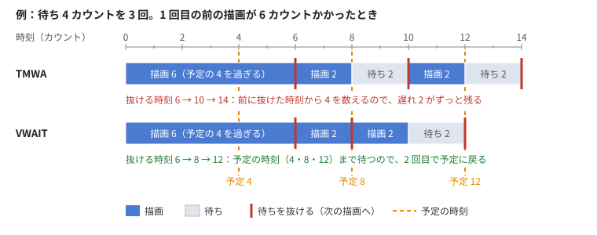

# panicCreationKitForWin のライブラリ（x68/lib/）と VWAIT

panic のスケジュール（.s）には、68000 のルーチンを書いて `BSUB`／`BSB1`／`BSB2` で呼び出せます。
panicCreationKitForWin では、こうした独自の拡張を **`x68/lib/` のライブラリ**としてまとめ、どの .s からも `.include` するだけで使えるようにしています。

この文書には次のことを書きます。

1. VWAIT（予定の時刻で待つ）の使い方
2. VWAIT を自分の .s に組み込む手順（ツールを使う場合と、X68000（実機・エミュレータ）の上でアセンブルする場合）
3. 時刻の記録（timelog）の使い方
4. FM 音源（Z-MUSIC）の曲と効果音を鳴らす命令
5. 新しい拡張をライブラリに加えるときの決まり

ツール全体の使い方は [MANUAL.md](MANUAL.md) を見てください。

---

## 1. ライブラリの中身

| ファイル            | 中身                                           | どこで `.include` するか        |
| ------------------- | ---------------------------------------------- | ------------------------------- |
| `x68/lib/vwait.h`   | VWAIT のマクロ（`VWINIT`、`VWAIT`）            | `sch.h` の後（ソースの頭）      |
| `x68/lib/vwait.s`   | VWAIT のルーチンの本体（`vw_init`、`vw_wait`） | `EXIT` の後、素材のラベルより前 |
| `x68/lib/timelog.h` | 時刻の記録のマクロ（`TLOG0`、`TLOG1`）         | `sch.h` の後                    |
| `x68/lib/timelog.s` | 時刻の記録のルーチンの本体（`tl_t0`、`tl_t1`） | `EXIT` の後、素材のラベルより前 |
| `x68/lib/zmusic.h`  | FM 音源のマクロ（`ZMPL`、`ZSEP` など。5 章）   | `sch.h` の後                    |
| `x68/lib/zmusic.s`  | FM 音源のルーチンの本体（`zm_play` など）      | `EXIT` の後、素材のラベルより前 |

- 文字コードは Shift-JIS、改行は CRLF です（X68000 の HAS でそのままアセンブルできます）。
- `buildPan.py`（mkanim・mkscene・mkparts も中で使います）は、ビルドのたびに `x68/lib/` のファイルを作業フォルダに写します。
  そのため .s の側では `.include vwait.h` と書くだけでよく、パスを書く必要はありません。
- ソースと同じフォルダに同じ名前のファイルを置くと、そちらが優先されます（ライブラリを直して試したいとき用）。
- ライブラリのファイルは MIT-0 です（[LICENSE](../LICENSE)）。自分の .s や .pan に入れて配っても、表示は要りません。無保証です。

---

## 2. VWAIT とは

### 2.1 TMWA の困る点

panic.x の `TMWA n` は「**前の TMWA を抜けてから** V-Sync を n 回数えるまで待つ」命令です。1 カウントは V-Sync 1 回で、約 18.03ms です。

- 描画が待ちの時間の中に収まれば、描画にかかった時間は待ちの中に吸収されるので、コマの間隔は正確になります。
- 描画が待ちより長くかかると、TMWA は「次の V-Sync まで待って数え直す」だけです。**遅れた分は取り戻されません。**
  そのため、遅い機械（10MHz など）ほど、全体の再生時間が延びます。音とずれる原因にもなります。

### 2.2 VWAIT がすること

`VWAIT n` は「**再生の頭（VWINIT の所）から数えた予定の時刻**」を n カウント進め、その時刻になるまで待ちます。



**カウントの起点**：時間は `VWINIT` の所を 0 として、ずっと数え続けます。`VWAIT` のたびに 0 に戻すことはしません。

予定の時刻は「VWINIT から後の VWAIT の n の合計」です。そのため、`VWAIT n` の待ちの起点は、**前の VWAIT の「予定の時刻」**です。
前の VWAIT を実際に抜けた時刻ではありません。

例：`VWAIT 4` を 3 回（単位はカウント）。

|                  | 予定の時刻 | 間に合ったとき：抜ける時刻 | 1 回目の前の描画が 6 かかったとき：抜ける時刻   |
| ---------------- | ---------- | -------------------------- | ----------------------------------------------- |
| VWINIT           | 0          | 0                          | 0                                               |
| 1 回目 `VWAIT 4` | 4          | 4                          | 6（予定を過ぎていたので、次の V-Sync で抜ける） |
| 2 回目 `VWAIT 4` | 8          | 8                          | 8（前の予定 4 から 4 後。待ちは 2 だけ）        |
| 3 回目 `VWAIT 4` | 12         | 12                         | 12                                              |

- 間に合っているときは、前の VWAIT を抜けた時刻と前の予定の時刻が同じなので、TMWA（前の TMWA を抜けてから n）と同じ動きです。
- 遅れたときだけ違います。TMWA なら 2 回目は 6＋4＝10 で抜け、遅れたままです。VWAIT は予定の 8 で抜けるので、遅れが消えます。

- 遅れたコマがあっても、予定の時刻は動きません。そのため、後のコマに余裕があれば、その分だけ待ちが短くなり、予定の時刻に追いつきます。
- 予定の時刻をすでに過ぎていたときは、次の V-Sync まで待つだけで先へ進みます。待たずに進むと画面が乱れるためです。
- 待っている間も ESC を見ていて、押されたらすぐ戻ります。panic.x は次の命令で終了します。

例として、1 コマ 4 カウントのデータで、重いコマ（7.4 カウントかかる）1 つと軽いコマ 3 つを 4 回くり返す場合です。

| 待ち方 | 実際の再生時間 | 予定        |
| ------ | -------------- | ----------- |
| TMWA   | 80 カウント    | 64 カウント |
| VWAIT  | 64 カウント    | 64 カウント |

10MHz のエミュレータでは、TMWA の 1.44 秒に対して VWAIT は 1.15 秒で、予定どおりでした。24MHz ではどちらも遅れが起きないので、同じ長さになります。

**効かない場合**：VWAIT が取り戻せるのは「後のコマに余裕（1 V-Sync 以上）があるとき」だけです。
どのコマも待ちより長くかかるデータは、VWAIT でも遅れたままです。その場合は、描く量を減らすか、待ちを長くしてください。

### 2.3 ツールでの使い方

mkscene・mkanim・mkparts の待ち方は、**既定で VWAIT** です。TMWA にしたいときは次のように指定します。

- mkscene の設定ファイル：`wait = "tmwa"`
- mkanim・mkparts：`--wait tmwa`

---

## 3. VWAIT を自分の .s に組み込む

### 3.1 命令（マクロ）

| マクロ              | 意味                                                                                                                               | 中身                      |
| ------------------- | ---------------------------------------------------------------------------------------------------------------------------------- | ------------------------- |
| `VWINIT`            | 経過の時間と予定の時刻を 0 にする（ここからカウントを始める）                                                                      | `BSUB vw_init`            |
| `VWADJ every,delta` | 補正：予定の時刻が every カウント進むごとに、予定の時刻へ delta カウントを足す（負＝早める、正＝遅らせる。every＝0 でやめる。3.3） | `BSB2 vw_adj,every,delta` |
| `VWAIT n`           | 予定の時刻を n カウント進め、VWINIT からの経過がそこになるまで待つ（n は TMWA と同じ単位。起点は前の VWAIT の予定の時刻。2.2）     | `BSB1 vw_wait,n`          |

### 3.2 手順

TMWA で書いた .s を VWAIT にする手順です。

1. `.include sch.h` の次の行に `.include vwait.h` を足す。
2. 再生の頭で、タイマーを V-Sync にそろえる `TMWA 1` の直後に `VWINIT` を置く。`TMON` はいつもどおり先に要ります。
3. コマの間の `TMWA n` を `VWAIT n` に置き換える。
4. `EXIT` の後、素材のラベル（`.include 名前_d.h` や素材の `.insert` など）より前に、`.include vwait.s` を置く。

```
	.include	sch.h
	.include	vwait.h		* 1. マクロ

	TMON
	GPAL	pal
	DRW0	0,0,c000
	SCL0	0,0
	TMWA	1			* 2. タイマーの基準
	VWINIT				*    ここから予定の時刻を数える
	PCMP	pcm,pcm_end-pcm

	DRW0	256,0,c001
	SCL0	256,0
	VWAIT	4			* 3. TMWA 4 の代わり
	DRW0	0,0,c002
	SCL0	0,0
	VWAIT	4

	PCMS
	DEND
	EXIT

	.include	vwait.s		* 4. ルーチンの本体（EXIT の後）

	.include	anim_d.h	* 素材のラベル（最後）
	.end
```

### 3.3 注意

- **キー待ちなどで止めた後は `VWINIT` をもう一度置きます。** 予定の時刻は止まっている間も進んでいるので、
  そのままだと、止めていた時間を取り戻そうとして、後のコマが待たずに続けて進んでしまいます。
  ```
  wait1:	TMWA	1
  	RTOK
  	IFEQ	0,wait1
  	VWINIT				* キーが押された所から数え直す
  ```
- **TMWA と VWAIT を混ぜるときも、TMWA の後に `VWINIT` を置きます。** TMWA は V-Sync のカウンタを 0 に戻すので、
  TMWA で待った分は VWAIT の経過時間に入りません。
- **一定時間ごとの補正**：`VWINIT` の後に `VWADJ every,delta` を置くと、予定の時刻が every カウント進むごとに delta カウントを足します。
  待ちは整数カウントなので、fps から決めた 1 コマの長さの端数が積み重なって音とずれるとき、これで直します。
  例：`VWADJ 1503,-1`（1503 カウント＝約 27.1 秒ごとに 1 カウント早める）。10MHz のエミュレータで、2 秒のデータに 0.5 秒ごとの補正を付けて
  1.95 秒（早める）・2.05 秒（遅らせる）になることを確かめています。`VWINIT` は数えた量を 0 に戻しますが、every と delta はそのまま残ります。
- 永久ループ（`GOTO` で頭に戻る）でも、そのまま使えます。ループの頭で `VWINIT` し直す必要はありません。
- VWAIT は **panic.x V1.38.01** の作業領域を使います。V-Sync のカウンタは `$2C8(A6)`、ESC の印は `$2E0(A6)` です。
  ほかの版の panic.x では確かめていません。
- PC 上のシミュレータ pansim は、ルーチンの頭の印（`'PTVI'`、`'PTVW'`）で VWAIT を見分けて、実機と同じように計算します。
  `vwait.s` を写して直すときも、この印は消さないでください。

### 3.4 ツールを使ってビルドする

自分で書いた .s を、buildPan で .pan にする場合です（[MANUAL.md](MANUAL.md) の 5 章「手で作る」も見てください）。

```
pt buildPan x68\anim\名前\名前.s
```

`x68/lib/` のファイルは自動で写されます。

### 3.5 X68000（実機・エミュレータ）の上でアセンブルする

ツールを使わず、当時の手順（HAS → HLK → mkpan）で作る場合です。

1. `x68/lib/vwait.h` と `x68/lib/vwait.s` を、.s と同じフォルダに写す（`sch.h` と同じ扱い）。
2. いつもどおりアセンブルする（`has -u 名前.s`、`hlk 名前.o`、`mkpan 名前.x`）。

`.include` を使わずに、`vwait.h` と `vwait.s` の中身を .s に直接貼ってもかまいません。その場合も、マクロは頭に、本体は `EXIT` の後に置きます。

---

## 4. 時刻の記録（timelog）

実機やエミュレータで、再生にかかった時間を測るためのルーチンです。mkscene・mkanim で `timelog = true`（`--timelog`）にすると、ツールが自動で入れます。

`TLOG0` の所と `TLOG1` の所で時刻（IOCS `_ONTIME`、1/100 秒）を取り、`TLOG1` でファイルに書きます。

```
T0=0067016B T1=00670233 EXPECT=200
```

T1 − T0（16 進）が測った時間です。この例では $C8＝200、つまり 2.00 秒です。EXPECT の後には、使う側が決めた文字（予想の値など）が入ります。

自分の .s で使うときは、次のように書きます。書くファイルの名前と EXPECT の後の文字は、ラベルで渡します。

```
	.include	sch.h
	.include	timelog.h

	TMON
	TMWA	1
	TLOG0				* ここから
	...
	TLOG1				* ここまでの時間を書く
	DEND
	EXIT

	.include	timelog.s
tl_fn:	.dc.b	'time.txt',0		* 書くファイル（カレントからの相対でも可）
tl_exp:	.dc.b	'200',13,10		* EXPECT= の後に書く文字
tl_exp_end:
	.even
```

- `TLOG0`／`TLOG1` は `BSUB tl_t0`／`BSUB tl_t1` と同じです。ツールが作る .s は `BSUB` の形のまま書いています（predict_time.py がこの行を目印にするため）。
- ファイルは書くたびに作り直します。DOS コールを使うので、時間を測る区間の外（`TLOG1` の後）で書き込みの時間がかかります。

---

## 5. FM 音源（zmusic）

Z-MUSIC ver2 の FM 音源の曲と効果音を、スケジュールの好きな所で鳴らす・止めるための命令です。
Z-MUSIC のファンクションコール（`trap #3`。Z-MUSIC のマニュアル ZM10.MAN）を、panic の命令と同じ書き方で使えるようにしたものです。
mkscene・mkanim・mkparts は、設定に FM 音源があると自動で入れます。準備・MML の書き方・効果音の決まりは [MANUAL.md](MANUAL.md) の 8 章を見てください。

### 5.1 命令（マクロ）

| マクロ                 | 意味                                                                                         | 中身                          | 使う Z-MUSIC の機能            |
| ---------------------- | -------------------------------------------------------------------------------------------- | ----------------------------- | ------------------------------ |
| `ZMPL 曲`              | 曲（.zmd）を頭から鳴らす。鳴っている曲は止めてから                                           | `BSB1 zm_play,曲`             | $11 play_cnv_data              |
| `ZMST`                 | 曲を止める（全部のトラック）                                                                 | `BSUB zm_stop`                | $0A m_stop                     |
| `ZMFO 速さ`            | 曲をフェードアウトする（1〜85。大きいほど速い）                                              | `BSB1 zm_fade,速さ`           | $1A fade_out                   |
| `ZSEP 効果音,トラック` | 効果音（.zse）を、曲のそのトラック（1〜32）に割り込ませて鳴らす                              | `BSB2 zm_se,効果音,トラック`  | $12 se_play                    |
| `ZSES 効果音,トラック` | `ZSEP` で鳴らした効果音を途中で止める（曲のそのトラックは続きから鳴る）                      | `BSB2 zm_sestop,効果音,トラック` | $12 se_play                 |
| `ZMVS 音色の表`        | 音色（.zmv）を登録する                                                                       | `BSB1 zm_voice,表`            | $04 m_vset、$1B m_vset2        |

- 曲・効果音・音色の表は、素材のラベルで書きます（`mml2zmd` や mkparts が作るファイルを、.json の素材の一覧に入れる）。
  素材は偶数番地に置きます（buildPan が並べる素材は、いつも偶数番地から始まります）。
- 曲は .pan の中に置いたまま鳴らします（Z-MUSIC にデータを写さない）。そのため Z-MUSIC は `zmsc -n -t0 -w0` の小さい常駐でかまいません（`-n` は初期化なし。付けると `ZMPL` が軽くなる）。
- `ZMPL` は、鳴っている曲を Z-MUSIC 自身が止めてから鳴らします（キーを離し、演奏するトラックを作り直す）。`ZMST` を前に置く必要はありません。
- **Z-MUSIC ver2 が常駐していないときは、どの命令も何もしません。** `trap #3` のベクタがメインメモリを指していて、その 8 バイト前に `'ZmuSiC'` と版（ver2）があるかを調べています。
- `ZSES` は、効果音と同じトラック・チャンネルに「すぐ終わる効果音」を割り込ませて止めます。効果音が鳴り終わったときと同じように、曲のそのトラックは続きから鳴ります。
- ESC で panic.x を抜けたときも、FM 音源は止まります（エミュレータで確認）。もし鳴り続けたら `zp -s` で止めます。

### 5.2 手順

1. `.include sch.h` の次の行に `.include zmusic.h` を足す。
2. 鳴らす所に `ZMPL`・`ZSEP` などを書く。効果音に音色の表があれば、鳴らす前に `ZMVS` を 1 回。
3. 終わりの `EXIT` の前に `ZMST`（曲を止める）。
4. `EXIT` の後、素材のラベル（`.include 名前_d.h`）より前に `.include zmusic.s` を置く。

```
	.include	sch.h
	.include	zmusic.h	* 1. マクロ

	TMON
	TMWA	1
	ZMVS	sv_se		* 効果音の音色を登録
	ZMPL	zm_bgm		* 2. 曲を頭から
	...
	ZSEP	se_se,8		*    効果音をトラック 8 に
	...
	ZMST			* 3. 曲を止める
	DEND
	EXIT

	.include	zmusic.s	* 4. ルーチンの本体（EXIT の後）

	.include	demo_d.h	* 素材のラベル（最後）
	.end
```

X68000 の上でアセンブルするときは、VWAIT と同じく `x68/lib/zmusic.h` と `zmusic.s` を .s と同じフォルダに写します。

### 5.3 時間

- 10MHz のエミュレータで測った時間：`ZMPL` は `zmsc -n` で常駐させたとき約 1ms、ふつうに常駐させたとき約 118ms。
  `ZMST` 約 25ms、`ZSEP` 約 0.3ms、`ZMVS` 約 0.2ms（音色 1 つ）。`ZMFO` は未計測です。
- `ZMST` は重いので、アニメの途中ではなく、終わるときに使うのが無難です。`-n` 無しの常駐での `ZMPL` も同じです。
- pansim は、ルーチンの頭の印（`'PTZP'`・`'PTZS'`・`'PTZF'`・`'PTZE'`・`'PTZX'`・`'PTZV'`）で見分けて、上の時間（未計測のものは仮の値）だけ進めます。音は鳴らしません。

---

## 6. 新しい拡張をライブラリに加える

VWAIT と同じ形で、自分の 68000 のルーチンをライブラリにする場合の決まりです。

### 6.1 ファイル

- `x68/lib/<名前>.h` にマクロを、`x68/lib/<名前>.s` にルーチンの本体を置く。
  名前は Human68k の 8.3 形式に収め、Shift-JIS・CRLF で書く。
- マクロは `sch.h` と同じ書き方（`名前: .macro 引数` … `.endm`）にする。
  中では sch.h の `BSUB`（引数なし）・`BSB1`（D0 に引数 1 つ）・`BSB2`（D0・D1 に引数 2 つ）を使う。
- **マクロの名前を sch.h の命令と重ねない**こと。sch.h の命令は 4 文字の大文字（`TMWA`、`DRW0` など）が多いので、
  一覧を確かめてから決める。
- **ラベルには拡張ごとの頭の文字を付ける**こと（VWAIT は `vw_`）。ツールが使っている頭の文字：
  `vw_`（VWAIT）、`tl_`（時刻の記録）、`zm_`（FM 音源）、`bn_`（ベンチ動画）、`pcm_`（音のカウンタ）、`quit`。

### 6.2 ルーチンの書き方

- `rts` で戻る。使ったレジスタは戻す（`movem.l` で積む）。D0・D1 は BSB1／BSB2 の引数なので、壊してよいかは自分で決めてよいが、戻すほうが安全。
- **A4・A6 は壊さない**。A6 は panic.x の作業領域を指す。
- D7 は panic.x のシステム変数（`SETR`・`IFEQ` などで使う）。結果を返したいときは D7 に入れてもよい。そうするときは、マクロの説明にそう書く。
- 長く待つルーチンは、待っている間に `tst.b $2e0(a6)` で ESC の印を見て、立っていたら戻る。panic.x は命令ごとにこの印を見て終了する。
- データ（変数）はルーチンの後ろに置き、`.even` でそろえる。

### 6.3 pansim に教える（時間のかかるルーチンのとき）

pansim は、BSUB などで呼ぶルーチンを「時間 0」として飛ばします。待つルーチンや、時間のかかるルーチンの場合は、次のようにします。

1. ルーチンの頭を `bra.s 本体` ＋ 4 バイトの印（`.dc.b 'PT??'`。拡張ごとに別の文字）にする。
2. `tools/pansim.py` の BSUB／BSB1／BSB2 を処理する所（`PTVI`／`PTVW` を見ている所）に、その印のときの計算を足す。

### 6.4 ツールから出す

- mkscene などが出す .s に組み込むときは、`tools/animcommon.py` の VWAIT の部品（`VWAIT_HEAD`、`VWAIT_INIT`、`vwait_line()`、
  `VWAIT_CODE`、`with_vwait_head()`）を手本にする。マクロの `.include` と、本体の `.include` の行を出すだけで済む。
- 使う側ごとに違う値（ファイル名など）が要るときは、時刻の記録の `timelog_code()` のように、ライブラリの側では
  ラベルを参照するだけにして、値は .s の側でラベルとして書く（ライブラリのファイルは書き換えずに済む）。
- buildPan.py が `x68/lib/` を自動で写すので、ビルドの側を直す必要はない。

### 6.5 確かめる

1. pansim で、再生時間と画面が予定どおりかを見る（`--sim`）。
2. 実機かエミュレータの **10MHz** で動かす。エミュレータでは、MPU クロックの設定を確かめてから動かすこと。
   時間を測るときは、`timelog = true` で time.txt を出すと比べやすい。
3. ESC やキーで止められるか、止めた後に音が残らないかも見る。
