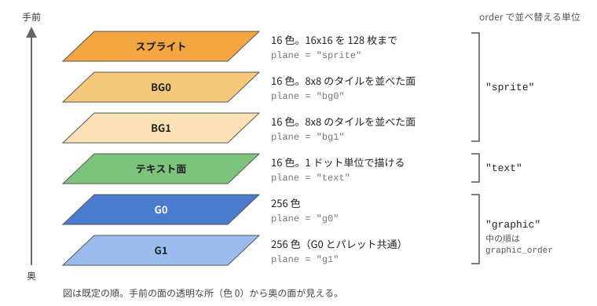
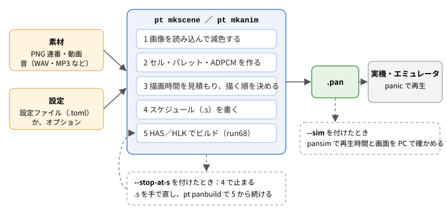
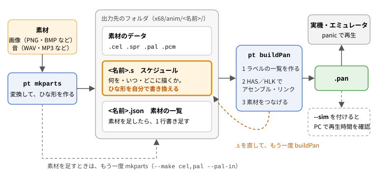
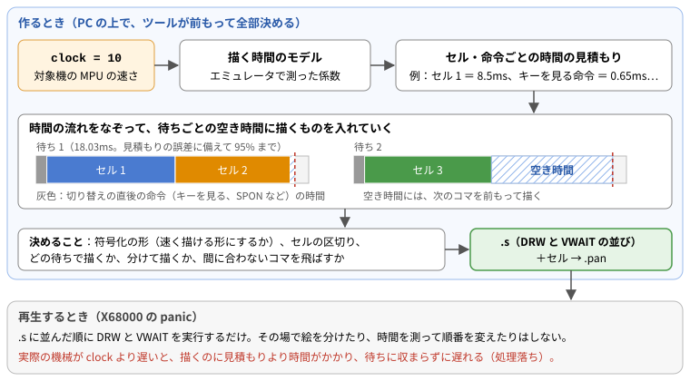
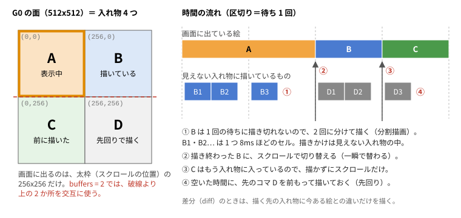
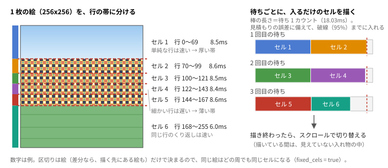

# panic データ制作ツール 使い方

Windows 上の素材（PNG 連番・動画・音声）から、X68000 用アニメーション再生システム ぱにっく（panic.x V1.38.01）の
データ（.pan）を作るツール群の使い方です。目標の対象機は **MPU 10MHz の X68000** です。再生は実機でもエミュレータでもかまいません。

---

## 1. できること

- PNG 連番または動画 1 本から、.pan を 1 コマンドで作る（`mkanim.py`）。
- グラフィック 0／1、テキスト面、スプライト、BG 面を重ねたアニメを、設定ファイル（TOML）から作る（`mkscene.py`）。
  X68000 の画面は次の面が重なってできていて、層（`[[layer]]`）ごとにどの面に置くかを `plane` で選びます。

  

  - 枚数の違う層どうしのタイミング合わせ、表示する順番と表示時間の指定、重なり順の変更。
  - 永久ループ＋キーで終了、音（ADPCM）の再生と鳴らし直し。
  - FM 音源の曲と効果音（Z-MUSIC ver2 の MML から。8 章）。
  - 10MHz で間に合うように、描画時間を見積もって符号化を調整し、必要なら分割して描く・コマを飛ばす。
- 素材の変換だけをツールに任せ、スケジュール（.s）を自分で書いて作る（`mkparts.py`＋`buildPan.py`。5 章）。
- 自動で作った .s で止めて人が手直しし、続きから .pan を作る（`buildPan.py`）。
- .pan を PC 上で実行して、再生時間と画面を確かめる（`pansim.py`）。

---

## 2. 準備

**`setup.bat` をダブルクリック**すると、必要なものを自動でダウンロードして、このフォルダの中に置きます
（Windows には何もインストールしません。最初の 1 回だけインターネット接続が必要、全部で約 130MB）。
何を取るかと版・SHA-256 は `tools/setup/deps.json` にあります。詳しくは一番上の README.md。

| もの                                     | 用途                                               | 置く場所          |
| ---------------------------------------- | -------------------------------------------------- | ----------------- |
| Python 3.13（埋め込み版）、Pillow、numpy | ツール本体                                         | `runtime/python/` |
| ffmpeg                                   | 動画の切り出し、音声の読み込み                     | `runtime/ffmpeg/` |
| run68x                                   | X68000 のプログラム（HAS／HLK）を Windows で動かす | `runtime/run68/`  |
| HAS060X、HLK evolution                   | X68000 のアセンブラとリンカ                        | `x68/bin/`        |
| panic.x、sch.h                           | panic の再生器とマクロ                             | `x68/`            |
| Z-MUSIC ver2.08、そのマニュアル          | FM 音源のドライバ（8 章）                          | `x68/zmusic/`、`docs/zmusic/` |

- `setup.bat --samples` でサンプルの素材（テストアニメの PNG、Big Buck Bunny 10 秒）も用意します。
  Big Buck Bunny は `--samples` のときだけダウンロードします（CC BY 3.0。入手元とクレジットは README.md の表）。
- ツールは `pt.bat` から動かします：`pt mkscene 設定.toml`（`pt` だけで一覧）。このマニュアルのコマンドの例も、すべて `pt` の形で書いてあります。
  `pt` は、setup.bat が用意した Python（`runtime\python\`）で `tools\<名前>.py` を動かします。

> **自分の（インストール済みの）Python を使う場合の注意**
>
> - `python tools\mkanim.py …` のように `python` で直接動かすと、`runtime\python\` ではなく、パソコンにインストールしてある Python が使われます。
>   `pt` も、`runtime\python\` が無いとき（setup.bat をまだ実行していないとき）は、インストールしてある Python を使います。
> - その場合は、その Python（3.11 以上）に、ツールが使うパッケージ（Pillow、numpy）を入れておいてください：`pip install -r requirements.txt`。
>   入っていないと、ツールはエラーで止まります。
> - ffmpeg・run68x・アセンブラなどは、`python tools\setup\setup.py` で用意できます（setup.bat と同じ。Python は入れません）。
> - `python tools\〇〇.py 引数…` は `pt 〇〇 引数…` と同じ動きです（使う Python だけが違います）。

- 外部のプログラムの場所は、環境変数 `FFMPEG`、`RUN68`、`PANTOOL_HAS`、`PANTOOL_HLK`、`PANTOOL_ZMUSIC`（ZMUSIC.X）で変えられます（`tools/paths.py`）。
- 再生の確認には、X68000 の実機かエミュレータが要ります（含みません）。エミュレータでは `x68/` を X68000 のドライブとして共有します
  （ホストのフォルダを共有する機能。WindrvXM など。以下の例では H: ドライブ）。実機へは .pan を写して使います。

### フォルダ

```
setup.bat  pt.bat  準備と、ツールの入口
tools/        ツール（Python）。tools/setup/ に準備の仕組み
x68/          X68000 側のファイル。エミュレータではここを共有する
  anim/<名前>/  作った .pan の既定の出力先
  bin/          HAS060X／HLK evolution（setup が置く）
  lib/          .s から .include する 68000 のルーチン（VWAIT、FM 音源など。docs/LIBRARY.md）
  zmusic/       Z-MUSIC ver2（setup が置く。8 章）
  work/         ビルドの作業フォルダ（自動で使う）
runtime/      setup がダウンロードした物（Python、ffmpeg、run68）
samples/      サンプルの素材と設定ファイル
docs/         このマニュアル、LIBRARY.md（ライブラリと VWAIT）。docs/panic/ に panic の付属ドキュメント（setup が PAN13801.LZH から置く。Shift-JIS）
```

- ビルド（run68 で動かす HAS／HLK）は短いパスの作業フォルダで行います。run68 上の HAS／HLK は長いパスを扱えないため、
  `x68/work` のパスが 60 文字を超えるときは `%LOCALAPPDATA%\pckwin\work` などを使います。
  それも長いときは、環境変数 `PANTOOL_WORK` に短いフォルダ（例 `C:\ptwork`）を指定してください。

コマンドは `panicCreationKitForWin` のフォルダ（setup.bat のあるフォルダ）で実行します（例：`pt mkanim …`）。

---

## 3. まず試す

サンプルの素材（PNG）は git には入っていないので、`setup.bat --samples` で用意するか、次のように作ります。

```
pt make_test_anim samples/anim2 32 --static     # 回る円（背景は止まっている）32 コマ
pt make_test_anim --layers                      # samples/layer1/ の層のサンプル（背景・キャラ・字幕・スプライトなど）
```

### PNG 連番 1 つから作る

```
pt mkanim samples/anim2 test1 --fps 12 --diff
```

`x68/anim/test1/test1.pan` ができます。X68000 の上で（`x68/` を H: に共有しているとして）：

```
H:\>panic anim\test1\test1.pan
```

### 動画から作る（音も動画から取る）

```
pt mkanim 動画.mp4 video1 --fps 12 --diff --start 10 --duration 5
```

### 層を重ねる（設定ファイル）

```
pt mkscene samples/layer1/scene4.toml
```

サンプルの設定ファイル（`samples/layer1/*.toml`、`samples/buf4/*.toml`）に、項目の説明をコメントで書いてあります。

---

## 4. 作業の流れ

作り方は 2 通りあります。

|                    | 自動で作る（mkanim・mkscene）                                              | 手で作る（mkparts＋buildPan）                                                                     |
| ------------------ | -------------------------------------------------------------------------- | ------------------------------------------------------------------------------------------------- |
| ツールがすること   | 素材の変換から、描く順・分割描画・差分・コマの間引き・ループの展開まで全部 | 素材の変換（セル・パレット・ADPCM）と、ビルドだけ                                                 |
| 自分ですること     | 素材を用意して、設定ファイル（またはオプション）を書く                     | スケジュール（.s）を書く。何を・いつ・どこに描くかを全部自分で決める                              |
| 向いているもの     | 動画や連番のアニメを、10MHz で間に合うように手早く                         | タイトル画面、キーで分岐する作品、紙芝居、演出を 1 コマずつ決めたいもの。panic の命令を全部使える |
| 10MHz で間に合うか | ツールが見積もって合わせる                                                 | 自分で確かめる（mkparts が描く時間の目安を表示し、pansim で確かめられる）                         |
| 説明               | 4.1、6 章（mkanim）、7 章（mkscene）                                       | **5 章**                                                                                          |

### 4.1 自動で作る（mkanim・mkscene）



1. **素材を用意する**：256x256 の PNG 連番（ファイル名の順がコマの順）、または動画。音は WAV／MP3 など。

   大きさが違う画像は、縦横比を保って縮小し、中央の 256x256 を使います（`fit`）。
2. **設定ファイルを書く**（mkscene）か、**オプションを並べる**（mkanim）。
3. **作る**：`pt mkscene 設定.toml`。終わりに、描画が間に合うかの見積もりと警告が出ます（→ 12 章）。
4. **確かめる**：必要なら `--sim` を付けて pansim で再生時間と画面を確認。
5. **実機・エミュレータで見る**：`panic <出力先>\<名前>.pan`。`--timelog` で作ると、実際の再生時間が time.txt に書かれます。

### 4.2 自動で作った .s に手を入れる

自動で作ったものを土台にして、少しだけ手を入れたいときの方法です。

```
pt mkscene 設定.toml --stop-at-s      # 素材と .s を作って止める
（<出力先>/<名前>.s を編集する。Shift-JIS・CRLF。最後の .include <名前>_d.h は消さない）
pt buildPan <出力先>\<名前>.s                      # 続きから .pan を作る
```

自動で作った .s は、分割描画や差分のセルが細かく並び、くり返しも全部の周を書き並べるので、長くなります（7.6 の「.s が大きくなること」）。
人が読んで直すのには向きません。
最初から自分で組み立てたいときは、5 章の「手で作る」を使ってください。素材の足し方も 5.6 と同じです。

---

## 5. 手で作る（mkparts＋buildPan）

ツールには素材の変換とビルドだけを任せ、**何を・いつ・どこに描くか（スケジュール）は自分で書く**作り方です。
自動で作る mkanim・mkscene と違い、ツールは描く順や待ちを勝手に変えません。.s に書いたとおりに再生されます。
panic の命令（キーでの分岐、くり返し、サブルーチン、自分で書いた 68000 のルーチンなど）を、すべて自由に使えます。



### 5.1 ひととおりの流れ

例：タイトルの画像 1 枚、アニメのコマを入れたフォルダ、音 1 つから作る場合です。

```
pt mkparts title.png frames bgm.wav --name demo --fps 8       ① 素材とひな形を作る
（x68\anim\demo\demo.s をテキストエディタで書き換える）        ② スケジュールを書く
pt buildPan x68\anim\demo\demo.s --sim                        ③ .pan を作り、PC で再生時間を確かめる
H:\>panic anim\demo\demo.pan                                  ④ 実機・エミュレータで見る
```

- ① の mkparts は、素材を panic の形に変換し、「画像を順に表示して音を鳴らす」だけのひな形の .s と、素材の一覧（.json）を作ります（5.2）。
- ② で .s を自由に書き換えます（5.4、5.5）。素材が足りなくなったら、mkparts でもう一度変換して足します（5.6）。
- ③ の buildPan は、.s をアセンブルして、素材をつなげた .pan を作ります（5.7）。
- ②〜④ をくり返して仕上げます。

### 5.2 mkparts：素材とひな形を作る

```
pt mkparts <画像・音声・画像のフォルダ・MML…> --name 名前 [--make cel,pal,pcm,zmd,s] [--se 効果音の MML] [オプション]
```

画像（png、bmp、jpg、gif など）、音声（wav、mp3、ogg、flac など）、画像の入ったフォルダ（名前順）、FM 音源の MML（Z-MUSIC ver2 の .zms／.opm、または .zmd）を、いくつでも並べられます。
出力先は `x68/anim/<名前>/`（`--out` で変えられる）です。

| 作るもの（`--make`） | ファイル                            | 中身                                                                                         |
| -------------------- | ----------------------------------- | -------------------------------------------------------------------------------------------- |
| `cel`                | `<画像>.cel`（スプライトは `.spr`） | 選んだ面（`--plane`）のセル。下の表                                                          |
| `pal`                | `<名前>.pal`                        | パレット（全部の画像で共通。`--pal-each` で画像ごと、`--pal-in` で既存のパレットに色を足す） |
| `pcm`                | `<音声>.pcm`                        | ADPCM（15.625kHz）                                                                           |
| `zmd`                | `<MML>.zmd`、`<MML>.zse`、`.zmv`    | FM 音源の曲。`--se` で選んだ MML は効果音と音色の表（8 章）                                  |
| `s`                  | `<名前>.s`、`<名前>.json`           | ひな形のスケジュールと、素材の一覧。.s が使う素材も作る                                      |

- 既定は全部作ります。例：`--make cel,pal` でセルとパレットだけ。
- `--plane` で、どの面に使う形にするかを選びます。面ごとにセルの形式・色の数・パレット・命令が違います。

  | `--plane`          | セル                                                                                     | 色とパレット                                                | ひな形の命令                         |
  | ------------------ | ---------------------------------------------------------------------------------------- | ----------------------------------------------------------- | ------------------------------------ |
  | `g0`（既定）、`g1` | a_enc（256x256、1 枚まるごと。bpica.x と同じ形）                                         | 256 色（G0・G1 で共通）、`GPAL`                             | `DRW0`／`DRW1` と `SCL0`／`SCL1`     |
  | `text`             | 高速テキスト（TDRW の code #2、4 プレーン）                                              | 16 色（34 バイト）、`TPAL 0`                                | `DRWT` と `SCLT`                     |
  | `sprite`           | スプライトのセル（bpic -s と同じ形。透明でない所を 16 ドット単位で切り出し、位置も入る） | 16 色（34 バイト）、`TPAL <番号>`（`--sprite-pal`、既定 1） | `SPCG` で登録、`SPOF`／`SPON` で表示 |

  16 色の面は、黒＋14 色に減色します（理由は 13 章の「色の数について」）。スプライトは 1 枚 128 キャラ（16x16）、全部で 256 キャラまでです。
- 変換したセルごとに、**10MHz で描くのにかかる時間の見積もり**を表示します（例：「セル title.cel：592 バイト、描く時間の見積もり 47.5 ms」）。
  待ちの長さを決めるときの目安にします（5.8）。`--clock` で別のクロックの値にできます。
- ファイル名は Human68k に合わせて英数字 8 文字までに縮めます（重なるときは番号を付ける）。
- すでに .s があるときは上書きしません（手直しを消さないため）。ただし **`--make` に `s` を入れると .json は作り直します**。
  .json に手で書き足した後は、`--make` に `s` を入れないでください（5.6）。
- `--build` を付けると、ひな形のまますぐに .pan も作ります。
- 画像のオプション（`--dither`、`--fast`、`--aspect`、`--fit`、`--transparent`）、音のオプション（`--gain`、`--start`、`--duration`）は mkanim と同じです（6 章）。
  `--fast` は、データが少し大きくなっても速く描ける形に符号化します（既定は bpica.x と同じ符号化）。
- ひな形の待ちは VWAIT（予定の時刻で待つ。7.1 の注）です。`--wait tmwa` で panic.x の TMWA にできます。`--fps` でひな形の切り替えの速さを決めます（既定 2）。
- 色の少ない画像なら、png2cel.py（bpica.x 互換）と同じセル・パレットになります。

### 5.3 フォルダの中身

| ファイル         | 作るもの | 中身                                                                        |
| ---------------- | -------- | --------------------------------------------------------------------------- |
| `<名前>.s`       | mkparts  | スケジュール。**自分で書き換える**。Shift-JIS・CRLF                         |
| `<名前>.json`    | mkparts  | 素材の一覧。.pan の後ろにつなげる素材と、そのラベル。素材を足したら書き足す |
| `*.cel`、`*.spr` | mkparts  | セル（グラフィック・テキスト）、スプライトのセル                            |
| `<名前>.pal`     | mkparts  | パレット                                                                    |
| `*.pcm`          | mkparts  | ADPCM                                                                       |
| `<名前>_d.h`     | buildPan | 素材のラベル（.json から毎回作る。編集しない）                              |
| `<名前>.pan`     | buildPan | できあがり                                                                  |

.json の中身は次のような形です。`parts` の並びの順に、素材が .pan の後ろにつながります。

```
{
 "name": "demo",
 "clock": "10mhz",
 "parts": [
  ["pal", "demo.pal"],
  ["c_title", "title.cel"],
  ["c_c001", "c001.cel"],
  ["pcm_bgm", "bgm.pcm"]
 ]
}
```

（ほかの項目もありますが、そのままにしておきます。）

### 5.4 .s の書き方

**決まり**

- 文字コードは **Shift-JIS**、改行は **CRLF** で保存します（X68000 のアセンブラ HAS で読むため）。
- 命令は行の頭にタブを入れて書き、ラベル（飛び先の名前）は行の頭から書きます。`*` で始まる行と、命令の後ろにタブを空けて `*` から書いたものはコメントです。
- 命令の一覧と詳しい説明は、setup が置く `docs/panic/` の付属ドキュメント（sch.h、panic.doc など）にあります。

**骨組み**（mkparts のひな形もこの形です）

```
	.include	sch.h		* panic の命令（最初に必ず）
	.include	vwait.h		* VWAIT を使うとき

	TMON				* タイマーを動かす
	GPAL	pal			* パレット
	TMWA	1			* タイマーの基準
	VWINIT				* VWAIT の基準の時刻
	（ここに、描く・切り替える・待つ を並べる）
	DEND				* 画面を元に戻す
	EXIT				* 終わり（書き忘れると暴走する）

	.include	vwait.s		* VWAIT の本体（EXIT の後に置く）
	.include	<名前>_d.h	* 素材のラベル（いちばん最後に置く。消さない）
	.end
```

**素材のラベル**：.s の中では、素材を .json に書いたラベルで指します。mkparts が付けるラベルは次のとおりです。

| 素材               | ラベル                                                      |
| ------------------ | ----------------------------------------------------------- |
| グラフィックのセル | `c_<ファイル名>`（例：title.cel → `c_title`）               |
| テキスト面のセル   | `t_<ファイル名>`                                            |
| スプライトのセル   | `s_<ファイル名>`                                            |
| パレット           | `pal`                                                       |
| 音（ADPCM）        | `pcm_<ファイル名>`。終わりは `pcm_<ファイル名>_end`（自動） |

**よく使う命令**

| 命令                             | すること                                                                                 |
| -------------------------------- | ---------------------------------------------------------------------------------------- |
| `DRW0 x,y,セル`／`DRW1 x,y,セル` | G0／G1 の (x,y) にセルを描く。x・y は 0 か 256（512x512 の面の 4 か所。7.6 の図）        |
| `SCL0 x,y`／`SCL1 x,y`           | G0／G1 の、画面に出す所を (x,y) にする（スクロール）                                     |
| `DRWT x,y,セル`、`SCLT x,y`      | テキスト面に描く、テキスト面の画面に出す所                                               |
| `GPAL pal`、`TPAL 番号,パレット` | グラフィックのパレット、テキスト（0）・スプライト（1〜15）のパレット                     |
| `SPCG パレット,セル`             | スプライトのパターンを登録する（最初にまとめて）                                         |
| `SPON セル`、`SPOF`              | スプライトを表示する、全部消す                                                           |
| `PCMP 音,長さ`、`PCMS`           | 音を鳴らす（例：`PCMP pcm_bgm,pcm_bgm_end-pcm_bgm`）、止める                             |
| `VWAIT n`                        | 予定の時刻を n カウント（1 カウント ≒ 18.03ms）進めて、そこまで待つ                      |
| `VWINIT`                         | 予定の時刻を数え直す（最初と、キー待ちの後）                                             |
| `TMWA n`                         | 前の TMWA から n カウント待つ（panic.x の待ち。遅れは取り戻さない）                      |
| `BKEY キー,飛び先`               | キーが押されるまで待ち、そのキーなら飛ぶ（違えば次の行へ）。キーは `$20`（スペース）など |
| `IKEY キー,飛び先`               | 待たずにキーを見て、押されていれば飛ぶ                                                   |
| `GOTO 飛び先`                    | 飛ぶ（永久ループなど）                                                                   |
| `SETR n` … `LOOP 飛び先`         | くり返し。`LOOP` は回数（D7）を 1 減らし、-1 になるまで飛び先へ戻る（`SETR 2` で 3 回）  |
| `GSUB 飛び先`、`RTSB`            | スケジュールの中のサブルーチンを呼ぶ、戻る                                               |

**見えない所に描いて切り替える**：描いている途中の絵が見えないように、G0 の見えていない所（例：(256,0)）に `DRW0` で描き、
描き終わってから `SCL0` で切り替えます（mkparts のひな形はこの形で、(0,0) と (256,0) を交互に使います）。
仕組みは 7.6 の図を見てください。

VWAIT の仕組みと、キー待ちと組み合わせるときの注意は [LIBRARY.md](LIBRARY.md) にあります。

### 5.5 例：タイトル → キー待ち → アニメを 3 回 → 終わり

5.1 の mkparts で作った素材（`c_title`、`c_c001`、`c_c002`、`pcm_bgm`）を使う例です。

```
* demo.s : タイトル → キーを待つ → 音を鳴らしてアニメを 3 回 → 終わり

	.include	sch.h
	.include	vwait.h

	TMON				* タイマーを動かす（最初に 1 回）
	GPAL	pal			* グラフィックのパレット
	TMWA	1			* タイマーの基準

* ---- タイトル ----
	DRW0	0,0,c_title		* (0,0) にタイトルを描いて
	SCL0	0,0			* そこを表示する
	BKEY	$20,start		* キーが押されるまで待つ（どのキーでも次の行へ進む）
start:
	VWINIT				* キーで止めた後は、ここから時刻を数え直す
	PCMP	pcm_bgm,pcm_bgm_end-pcm_bgm	* 音を鳴らす

* ---- アニメを 3 回 ----
	SETR	2			* LOOP は D7 を 1 減らし、-1 になるまで戻る（2 → 3 回）
again:
	DRW0	256,0,c_c001		* 見えていない (256,0) に描いて
	SCL0	256,0			* 表示を切り替える
	VWAIT	7			* 7 カウント（約 126ms）ごと
	DRW0	0,0,c_c002
	SCL0	0,0
	VWAIT	7
	LOOP	again

	PCMS				* 音を止める
	DEND				* 画面を元に戻す
	EXIT				* 終わり（書き忘れると暴走する）

	.include	vwait.s		* VWAIT の本体（EXIT の後）
	.include	demo_d.h	* 素材のラベル（buildPan が作る。いちばん最後）
	.end
```

`pt buildPan x68\anim\demo\demo.s` で .pan になります。

### 5.6 素材を足す

作っている途中で画像や音を足すときは、**同じ出力先に mkparts をもう一度動かし、.json に書き足します**。

```
pt mkparts frames2 --name demo --make cel,pal --pal-in x68\anim\demo\demo.pal
```

1. `--make` に `s` を入れません（.s と .json はそのまま）。出力先は `--name` が同じなら同じフォルダです（`--out` でも指定できる）。
2. グラフィックの画像は `--pal-in` で今のパレットを読み、足りない色を後ろに足します。今までの色の番号は変わらないので、
   前に作ったセルはそのまま使えます。パレットがいっぱい（256 色）のときはエラーになります。
3. できたファイルを `<名前>.json` の `parts` に書き足します。例：`["c_f010", "f010.cel"]`、`["pcm_se", "se.pcm"]`。
   ラベルは 5.4 の表のとおりに付けます（音の終わりのラベル `pcm_se_end` は自動でできます）。
4. .s で使って、buildPan し直します。

**別の面の素材を足すとき**（例：グラフィックのアニメに、テキスト面の字幕を足す）は、パレットの形が違うので、`--name` を変えて別のパレットにします。

```
pt mkparts jimaku.png --name demot --out x68\anim\demo --plane text --make cel,pal
```

`demot.pal` と `jimaku.cel` ができるので、.json に `["tpal", "demot.pal"]`、`["t_jimaku", "jimaku.cel"]` を書き足し、
.s では `TPAL 0,tpal`、`DRWT 0,0,t_jimaku`、`SCLT 0,0` のように使います（ラベルの名前は自由です。.json と .s で同じにします）。

- 同じ名前のファイルがあると上書きします。
- 自分で用意したデータ（ほかのツールで作ったセルや、自分で作った表など）も、フォルダに置いて .json に書けば、同じようにラベルで使えます。

### 5.7 buildPan：.pan を作る

```
pt buildPan <名前>.s [--sim] [--clock 10]
```

- .s と同じフォルダに `<名前>.json` があると、次のことをします。
  1. .json から素材のラベルの一覧（`<名前>_d.h`）を作る。
  2. .s を HAS でアセンブルし、HLK でリンクする（run68 で動かす。`x68/lib/` のライブラリと sch.h は自動で使える）。
  3. .json の素材を順に .pan の後ろにつなげ、中身が正しくつながったかを確かめる。
- .s の代わりに、フォルダや .json を指定しても同じです。
- .json が無い .s は、そのまま .pan にします（素材を .s の中に直接書いたものなど。`buildPan.py 名前.s 追加の.o …` で .o もリンクできる）。
- できた .pan は .s と同じフォルダに書きます。
- `--sim` を付けると、できた .pan を pansim で動かして再生時間を表示します（10 章。キー待ちのあるデータでは、キーは押されないものとして進めます）。
- アセンブルのエラーは HAS のメッセージ（ファイル名・行番号・内容）がそのまま出ます。行番号は .s の行です。
- panbuild.py も、フォルダか .json を指定したときの buildPan と同じことをします。

### 5.8 10MHz で間に合わせるには

手で作るときは、ツールは描く時間を調整しません。次の目安で待ちの長さを決め、pansim で確かめます。

- **待ちの長さ**：mkparts が表示する「描く時間の見積もり」を 18.03 で割り、それより大きい整数を、そのコマの `VWAIT` にします。
  例：47.5 ms → 2.6 → `VWAIT 3` 以上。1 枚まるごとの絵は 10MHz で 50〜80 ms くらいかかるので、`VWAIT 4`〜`5`（毎秒 11〜14 枚）が目安です。
- G0 と G1 の両方を描くコマは、その合計の時間がかかります。
- 間に合わないと、そのコマは遅れます（処理落ち）。VWAIT なら後のコマに余裕があれば取り戻せますが、ずっと間に合わないと全体が延びます。
- 速くしたいとき：`--fast` で符号化する、絵を単純にする（色を減らす、ディザをやめる）、描く所を小さくする。
- 確かめ方：`pt buildPan <名前>.s --sim`、または `pt pansim <名前>.pan` で「遅れた TMWA」の回数を見ます。
  最後は実機・エミュレータで確かめてください（`--timelog` 相当の時刻の記録は [LIBRARY.md](LIBRARY.md) の timelog）。

---

## 6. mkanim.py（重ね合わせの無いアニメーションを 1 コマンドで）

```
pt mkanim <PNG のフォルダ | 動画> <名前> [オプション]
pt mkanim --config 設定.toml [オプション]
```

`--config` の設定ファイルには、オプション名（`-` は `_` でもよい）を書きます。例：`samples/bbb/bbb.toml`。
コマンドラインで指定したものが優先です。中身は mkscene（G0 に 1 枚の層）と同じなので、7 章の説明も参考にしてください。

| オプション                            | 意味                                                                                  | 既定                           |
| ------------------------------------- | ------------------------------------------------------------------------------------- | ------------------------------ |
| `<名前>`                              | 出力名。英数字 8 文字以内（Human68k の 8.3）                                          | —                              |
| `--out フォルダ`                      | 出力先                                                                                | `x68/anim/<名前>/`             |
| `--fps N`                             | 1 秒あたりのコマ数（60 まで）                                                         | 12                             |
| `--loop N`                            | N 回くり返して 1 本にする                                                             | 1                              |
| `--forever`                           | 永久ループ（キーで終了）                                                              | —                              |
| `--exit-key any／space／return／none` | 永久ループを終わらせるキー（none は ESC だけ）                                        | any                            |
| `--diff`                              | 前フレーム差分を使う（ほとんどの素材で速く・小さくなる）                              | 使わない                       |
| `--dither none／fs／ordered`          | 減色のときのディザ。止まった背景なら ordered が差分と相性がよい                       | none                           |
| `--dither-strength N`                 | ordered の強さ                                                                        | 24                             |
| `--stabilize N`                       | 前のコマとの色の差が N 以下のドットは前の色のまま（実写のゆらぎ対策。目安 16〜24）    | 0                              |
| `--sequence 順番`                     | 表示する順番（7.4）                                                                   | 名前順                         |
| `--hold 指定`                         | 画像ごとの表示時間（7.4）                                                             | —                              |
| `--transparent 色`                    | 透明にする色（7.8）                                                                   | —                              |
| `--transparent-tolerance N`           | 透明色の許す差                                                                        | 0                              |
| `--aspect`                            | ドットの縦横比の補正（7.8）                                                           | しない                         |
| `--pixel-aspect R`                    | 1 ドットの横÷縦                                                                       | 1.5                            |
| `--fit crop／pad`                     | 256x256 への収め方（7.8）                                                             | aspect なら pad、なしなら crop |
| `--audio ファイル`                    | 音。動画なら指定しなくても動画の音を使う                                              | —                              |
| `--no-audio`                          | 動画の音を使わない                                                                    | —                              |
| `--gain dB`                           | 音量の調整                                                                            | 0                              |
| `--audio-offset 秒`                   | 音を鳴らし始める時刻（負なら音の頭を削る）                                            | 0                              |
| `--audio-every N`                     | 永久ループで N 周ごとに鳴らし直す（0 で最初の 1 回だけ）                              | 音の長さから自動               |
| `--start 秒`                          | （動画）何秒目から使うか                                                              | 0                              |
| `--duration 秒`                       | （動画）何秒分使うか                                                                  | 最後まで                       |
| `--split 秒`                          | 長い素材をこの長さごとの .pan に分ける（名前は 6 文字まで。ワイルドカードで連続再生） | —                              |
| `--clock 10` など                     | 対象機の MPU クロック（描画時間の見積もり。7.1 の `clock`）                           | 10mhz                          |
| `--no-drop`                           | 間に合わないコマを飛ばさず、遅らせる                                                  | 飛ばす                         |
| `--no-fixed-cels`                     | 分割描画の区切りをその時の空き時間で決める（7.7 の `fixed_cels`）                     | 区切りを決めたセル             |
| `--wait tmwa／vwait`                  | 待ち方（7.1 の `wait`）                                                               | vwait                          |
| `--adjust-every 秒 --adjust-frames N` | 一定時間ごとの補正（7.1 の `adjust_every`・`adjust_frames`）                          | なし                           |
| `--timelog`                           | 再生時間を time.txt に書く（確認用）                                                  | —                              |
| `--sim`                               | 最後に pansim で確かめる                                                              | しない                         |
| `--stop-at-s`                         | .s まで作って止める                                                                   | —                              |

---

## 7. mkscene.py（層を重ねたアニメーションを 1 コマンドで）

```
pt mkscene <設定.toml> [--out フォルダ] [--stop-at-s] [--sim]
```

設定ファイルは「全体の項目」と、`[[layer]]` を並べた「層の項目」からできています。書き間違えた項目や、
書く場所を間違えた項目はエラーで知らせます（例：「fps は層（[[layer]]）の中に書く項目です」）。

### 7.1 全体の項目

| 項目                                                                    | 意味                                                                                                                                             | 既定                                                 |
| ----------------------------------------------------------------------- | ------------------------------------------------------------------------------------------------------------------------------------------------ | ---------------------------------------------------- |
| `name`                                                                  | 出力名（英数字 8 文字以内）。必須                                                                                                                | —                                                    |
| `out`                                                                   | 出力先のフォルダ（設定ファイルからの相対）。`--out` が優先                                                                                       | `x68/anim/<名前>/`                                   |
| `clock`                                                                 | 対象機の MPU クロック：`10`、`16.7`、`"24mhz"` のように書く（1〜100MHz。下の注）                                                                 | 10mhz                                                |
| `loops`                                                                 | 全体の長さ＝基準の層の 1 ループ × loops（永久ループでは 1 周の長さ）                                                                             | 1                                                    |
| `loop = "forever"`                                                      | 永久ループ                                                                                                                                       | 1 回で終わる                                         |
| `exit_key`                                                              | `"any"`／`"space"`／`"return"`／`"none"`                                                                                                         | any                                                  |
| `diff`                                                                  | 前フレーム差分（層ごとに変えられる）                                                                                                             | false                                                |
| `dither`／`dither_strength`／`stabilize`                                | 減色（全層共通。6 章と同じ）                                                                                                                     | none／24／0                                          |
| `buffers`                                                               | グラフィックの描画先の数 2／4（7.7。層ごとにも書ける）                                                                                           | 4（永久ループで 4 だとくり返しが見つからなければ 2） |
| `fixed_cels`                                                            | 区切りを決めたセル（7.7。層ごとにも書ける）                                                                                                      | true                                                 |
| `order`                                                                 | 重なり順（手前から）：`["sprite", "text", "graphic"]` の並べ替え                                                                                 | この順                                               |
| `graphic_order`                                                         | グラフィックの中の順（手前から）：`["g0", "g1"]` か `["g1", "g0"]`                                                                               | g0 が手前                                            |
| `audio`                                                                 | 音のファイル（動画でもよい）                                                                                                                     | なし                                                 |
| `audio_start`／`audio_duration`                                         | 音のファイルの何秒目から何秒分を使うか                                                                                                           | 全部                                                 |
| `gain`                                                                  | 音量の調整 [dB]                                                                                                                                  | 0                                                    |
| `audio_offset`                                                          | 音を鳴らし始める時刻 [秒]（負なら音の頭を削る）                                                                                                  | 0                                                    |
| `audio_every`                                                           | 永久ループで何周ごとに鳴らし直すか（0 で最初の 1 回だけ）                                                                                        | 音の長さから自動                                     |
| `aspect`／`pixel_aspect`／`fit`／`transparent`／`transparent_tolerance` | 画像の読み込み方（7.8。全層の既定）                                                                                                              | —                                                    |
| `no_drop`                                                               | 間に合わないコマを飛ばさない                                                                                                                     | false                                                |
| `wait`                                                                  | 待ち方：`"tmwa"`（panic.x の TMWA。遅れは取り戻さない）／`"vwait"`（再生の頭からの予定の時刻で待ち、遅れたコマの分を後の待ちで取り戻す。下の注） | vwait                                                |
| `adjust_every`／`adjust_frames`                                         | 一定時間ごとの補正：`adjust_every` 秒ごとに待ちを `adjust_frames` カウント足す（負＝早める、正＝遅らせる。vwait のときだけ。下の注）             | なし                                                 |
| `timelog`                                                               | 再生時間を time.txt に書く                                                                                                                       | false                                                |
| `sim`                                                                   | 最後に pansim で確かめる（`--sim` と同じ）                                                                                                       | false                                                |

**クロック（`clock`）について**：再生する X68000 の MPU の速さ（MHz）です。mkanim・mkparts・pansim・buildPan では `--clock` で指定します。

- **何に使うか**：ツールは .pan を作るときに、「その速さの機械で、この絵を描くのに何 ms かかるか」を見積もり、
  それに合わせてデータを組み立てます（流れは 7.6 の図）。clock はこの見積もりにだけ使います。.pan の中にクロックは記録されず、
  再生するときに機械の速さを調べることもありません。
- **clock で変わること**：
  - **符号化**：待ちの間に描き切れない絵は、データが少し大きくなっても速く描ける形に符号化します。速いクロックでは、小さい形のままで間に合います。
  - **描く段取り**：1 回の待ちの間に何を描くか、どのコマを分けて描くか（分割描画）、どのコマを飛ばすかを決めます。
    遅いクロックほど、分割描画や飛ばすコマが増えます。
  - **作ったときの表示**：警告（間に合わない層など）と、`--sim` の再生時間は、このクロックでの値です。
- **実際の機械と違うクロックで作ると**：
  - **clock が実際より遅い**（10MHz で作って 24MHz の機械で再生）：問題なく再生できます。余った時間は待つだけです。
    ただし、本当は要らない分割や飛ばしたコマが入り、データも大きくなります。
  - **clock が実際より速い**（24MHz で作って 10MHz の機械で再生）：描画が待ちに収まらず、コマの切り替えが遅れます（処理落ち）。
    VWAIT が後のコマの余裕で取り戻せないほど遅れると、全体の再生時間が延び、音とずれます。
  - 例（`samples/layer1/scene4.toml`、2 秒、5 層）：

    | clock      | .pan の大きさ | 分割描画 | 10MHz で再生したとき（pansim）  |
    | ---------- | ------------- | -------- | ------------------------------- |
    | 10（既定） | 66KB          | 8 回     | 遅れなし                        |
    | 24         | 39KB          | 0 回     | 切り替えの遅れ（処理落ち）13 回 |

- **決め方**：再生したい機械のうち、**いちばん遅いもの**に合わせます。初代〜SUPER・XVI のどれでも再生したいなら、既定の 10 のままにしてください。
  作ったデータが別のクロックで間に合うかは、`pt pansim <名前>.pan --clock 24` のように確かめられます。
- **見積もりのもと**：エミュレータで測った値です。測ったクロックは 10、12、15、16.7（XVI）、17.4、20、24、25MHz で、
  その間のクロックは測った値から計算し、範囲の外は近いクロックから反比例で推定します（作るときに「対象機：…」と表示します）。
  16.7MHz 以上（XVI 系）では VRAM やスプライトへのアクセスが遅くなるので（塗り約 12％、SPOF 約 60％）、16MHz 以上はその分を見込みます。
  X68030（68030）はこの見積もりの外です。

**待ち方（`wait`）について**：panic.x の TMWA は、前の待ちからの V-Sync を数えて待ちます。描画が待ちの中に収まれば正確ですが、
描画が待ちより長くかかったコマは次の V-Sync まで遅れ、その遅れは取り戻されません（遅い機械ほど全体が延びる）。
`wait = "vwait"` は、.pan に入れた小さな 68000 のルーチンで「再生の頭からの予定の時刻」まで待ちます。遅れたコマがあっても、
後のコマに余裕（1 V-Sync＝18ms 以上）があれば、その分だけ待ちを短くして予定の時刻に戻します。ずっと間に合わないデータは取り戻せません。
既定は `vwait` です（10MHz で確認済み）。panic.x の TMWA だけで作りたいときは `wait = "tmwa"` にします。
仕組みと、自分の .s に組み込む手順は [LIBRARY.md](LIBRARY.md) を見てください。

**一定時間ごとの補正（`adjust_every`・`adjust_frames`）について**：待ちは V-Sync（1 カウント ≒ 18.03ms）単位なので、
永久ループの 1 周の長さは整数カウントに丸められ、その差が周ごとに積み重なって音と少しずつずれます。
永久ループでは、作るときに「絵は ○ 秒ごとに 1 カウント遅れます（fps どおりにするなら adjust_every = ○、adjust_frames = -1）」
と表示するので、その値を書けば fps どおりの速さになります。耳で合わせたいときは、`adjust_frames` の符号と `adjust_every` を変えて調整します。
例：`adjust_every = 27.1`、`adjust_frames = -1`（27.1 秒ごとに 1 カウント早める）。
早めた所では、そのコマの待ちが 1 カウント短くなるので、描画が間に合わず 1 回だけ V-Sync 1 回分遅れることがあります（次のコマで取り戻します）。

### 7.2 層の項目（`[[layer]]`）

| 項目                                                                    | 意味                                                                                                                                 | 既定              |
| ----------------------------------------------------------------------- | ------------------------------------------------------------------------------------------------------------------------------------ | ----------------- |
| `name`                                                                  | 層の名前（重ならないように）。必須                                                                                                   | —                 |
| `plane`                                                                 | `"g0"`／`"g1"`（グラフィック 256 色）、`"text"`（テキスト面 16 色）、`"sprite"`（スプライト 16 色）、`"bg0"`／`"bg1"`（BG 面 16 色） | g0                |
| `src`                                                                   | PNG 連番のフォルダ、または動画（設定ファイルからの相対）。必須                                                                       | —                 |
| `base`                                                                  | 基準の層（全部の中でちょうど 1 つ）                                                                                                  | false             |
| `fps`                                                                   | 1 秒に何コマ進めるか。基準の層には必須                                                                                               | —                 |
| `loop_ratio`                                                            | この層の 1 ループを、基準の層の 1 ループの何倍にするか（fps の代わり）                                                               | —                 |
| `start`／`duration`                                                     | （動画）何秒目から何秒分を使うか                                                                                                     | 全部              |
| `first`                                                                 | （PNG）使い始める画像の番号。ファイル名順に並べて**先頭が 0 番**                                                                     | 0                 |
| `count`                                                                 | （PNG）first から何枚使うか                                                                                                          | 最後まで          |
| `sequence`                                                              | 表示する順番（7.4）                                                                                                                  | 0, 1, 2, …        |
| `hold`                                                                  | 画像ごとの表示時間（7.4）                                                                                                            | —                 |
| `diff`                                                                  | この層だけ差分を使う／使わない                                                                                                       | 全体の diff       |
| `buffers`                                                               | この層だけ描画先の数を変える（2／4。グラフィックだけ。7.7）                                                                          | 全体の buffers    |
| `fixed_cels`                                                            | この層だけ区切りを決めたセルを使う／使わない（7.7）                                                                                  | 全体の fixed_cels |
| `aspect`／`pixel_aspect`／`fit`／`transparent`／`transparent_tolerance` | この層だけ読み込み方を変える                                                                                                         | 全体の値          |

同じ面（g0、g1、text、bg0、bg1）に置ける層は 1 つです。スプライトの層はいくつでも置けます（後に書いた層ほど手前）。

### 7.3 速さの決め方（fps・loop_ratio・loops）

「1 ループ」は、その層の画像を（sequence があればその順に）最後まで 1 回見せる長さです。

- 基準の層：1 ループ ＝ コマ数 ÷ fps 秒。例：12 枚で fps = 12 なら 1 秒。
- fps を書いた層：その層だけの速さ（基準と関係なく、コマ数 ÷ fps 秒で 1 ループ）。
- loop_ratio を書いた層：1 ループ ＝ 基準の 1 ループ × loop_ratio（コマ数は関係ない）。基準が 1 秒のとき、
  - 6 枚の背景に `loop_ratio = 1.0` → 背景も 1 秒で 1 ループ（1 コマ 1/6 秒）。基準と毎回同時に頭に戻る
  - `2.0` → 基準が 2 回ループする間に背景が 1 回、`0.5` → 基準が 1 回の間に背景が 2 回
- 永久ループでは、1 周（基準の 1 ループ × loops）の中で各層がちょうど整数回ループする必要があります。
  loop_ratio なら `loops ÷ loop_ratio` が整数になるように（loops = 2 なら 2、1、0.5 などは可、1.5 は不可）。

**切り替えの刻み**：panic の待ちは V-Sync（1 カウント ≒ 18.03 ms、1 秒に約 55.46 回）単位なので、
各コマの表示時間は ±半カウントの範囲で丸められます（12fps なら 5,4,5,5,4… カウント）。全体の長さはほとんどずれません。
55.46 を割り切れる fps（27.7、18.5、13.9、11.1、9.2…）にすると、全部のコマが同じ長さになって滑らかです。
永久ループは 1 周の長さを整数カウントに丸めるので、1 周が短いと速さが少しずれます（1 秒の周で最大 0.9% ほど）。

### 7.4 順番と表示時間（sequence・hold）

画像の番号は、PNG をファイル名順に並べて先頭を 0 番と数えます（first を書いたときは、使う範囲の先頭が 0 番）。

| 書き方 | 意味                                                                     |
| ------ | ------------------------------------------------------------------------ |
| `n`    | 画像 n                                                                   |
| `a-b`  | a から b まで（b < a なら逆順）                                          |
| `:x`   | 表示時間を既定のコマ（1/fps 秒）の x 倍。`:0.5s` のように s を付けると秒 |
| `*k`   | k 回くり返す。かっこでまとめられる：`(0-3)*4`                            |

例：`sequence = "0-7,6-1"`（往復）、`sequence = "0,1,2:3,(3-5)*4"`、`hold = "5:3,7:0.5s"`（画像 5 は 3 コマ分、7 は 0.5 秒）。
hold はその画像が出てくる所すべてに効きます（sequence の `:x` の方が優先）。同じ画像を何度使っても、データは 1 つで済みます。

### 7.5 永久ループ・キー・音

- `loop = "forever"` で、キーが押されるまでくり返します。待ちのたびにキーを調べます（1 回 約 0.65 ms）。ESC でも終わります。
- 音は周を数えて、`audio_every` 周ごとに頭から鳴らし直します（ループの本体は音の間隔と関係なく短くできる）。
- 終わるとき（キー、最後まで再生）に音も止めます（PCMS）。
- FM 音源の曲と効果音（`fm`、`[[se]]`）も、同じように時刻と何周ごとかを決めて鳴らせます（8 章）。

### 7.6 基本的な仕組み（見積もり・入れ物・分割描画・差分）

**すべて作るときに決まる（描く時間の見積もり）**

自動のツール（mkanim・mkscene）は、**.pan を作るときに**、何をどの待ちで描くかを全部決めます。
その元になるのが、`clock`（7.1）から見積もった描く時間です。



1. **見積もる**：`clock` に合わせて、セルを 1 つ描く時間や、命令 1 つの時間を見積もります（エミュレータで測った描く速さの係数から計算）。
2. **時間の流れをなぞる**：再生の頭から順に、待ちごとの**空き時間**を計算します。
   空き時間 ＝ 待ちの長さ × 95%（見積もりの誤差に備えた余裕）－ 切り替えの直後に実行する命令の時間 － すでに入れたセルの時間 です。
3. **決める**：空き時間に入るように、符号化の形（遅いときは、データが少し大きくても速く描ける形）、セルの区切り、どの待ちで描くか、
   何回かに分けて描くか、間に合わないコマを飛ばすかを決めます。空き時間が余れば、次のコマを前もって描きます。
4. **書き出す**：決めた結果を、.s（`DRW` と `VWAIT` の並び）とセルにして、.pan を作ります。

再生するときの panic は、.s に並んだ順に実行するだけで、その場で絵を分けたり、時間を測って順番を変えたりはしません。
そのため、見積もりより実際の機械が遅い（`clock` が実際より速い）と、描くのが待ちに収まらずに遅れます（7.1 の `clock`）。
手で作る場合（5 章）は、この見積もりと調整をしません（mkparts は描く時間の目安を表示するだけです）。

**描く時間をやりくりする仕組み**

10MHz の X68000 では、256x256 を全部描き直すと 1 枚に 55〜67ms かかり、待ち 1 カウント（約 18ms）に収まりません。
そこでツールは、上の見積もりを使って、次のようにして描く時間をやりくりします。



- **入れ物**：G0・G1 はそれぞれ 512x512 で、画面に出るのはそのうちの 256x256 です。残りの見えない所（入れ物）に次のコマを描き、
  描き終わったらスクロールの位置を変えて一瞬で切り替えます。描きかけの絵は見えません。
- **分割描画**：1 コマを 1 回の待ちの間に描き切れないときは、何回かの待ちに分けて少しずつ描き進めます（図の ①）。
  描く単位は**セル**（1 回で描くひとまとまりのデータ。`fixed_cels` では 1 つ 8ms ほど）です。
- **差分（`diff`）**：描く先の入れ物に今ある絵と、次に出す絵を比べて、変わった所だけを描きます。動きが一部だけの絵では、描く量がほぼ半分になります。
- 締め切り（そのコマを出す時刻）までに描き終わらないコマは飛ばします（`no_drop` なら遅れても描き切ります）。

**1 枚の絵をセルに分ける方法**（既定の `fixed_cels = true`）



- 絵を**横に区切った行の帯**に分けます。1 つの帯が 1 つのセルです。
- 上の行から順に足していき、描く時間の見積もりが**約 8.6ms**（待ち 1 カウント 18.03ms の 95% の半分）を超える手前で区切ります。
  そのため、1 カウントの待ちにセルが 2 つずつ入ります。
- 描く時間は行の中身で決まるので、帯の厚さは場所によって違います。
  - 同じ色が続く行や、上の行と同じ行は速く描けるので、帯が厚くなります（図の空や地面）。
  - 色が細かく変わる行は遅いので、帯が薄くなります（図の真ん中）。
  - 同じ行のくり返しのように 1 つにまとめて描く行は、途中で切れません。そのため、8.6ms を少し超えるセルもあります。
- 差分（`diff`）の層では、描く先の入れ物にある絵と同じ行はほとんど時間がかからないので、変わっていない所は厚い帯になります。
- 描くときは、待ちごとに、待ちの 95% に入るだけのセルを上から順に描きます（待ちが n カウントなら、その n 倍の時間）。
  コマの最後のセルを描き終わったら、スクロールで切り替えます。.s では、セルごとに描く位置をずらした命令になります。

  ```
  	DRW0	256,0,c012		* chara 3 行 0〜69
  	DRW0	256,70,c013		* chara 3 行 70〜99
  	VWAIT	1
  	DRW0	256,100,c014		* chara 3 行 100〜121
  	…
  ```

- 区切りは絵（差分なら、描く先にある絵も）だけで決まります。そのため、同じ絵はどの周でも同じセルになり、データが増えません（7.7）。
- セルに分けるのは、**ツールが .pan を作るとき**です。panic は再生中に絵を分けたりせず、.pan に入っているセルを、.s に並んだ `DRW` の順に描くだけです。
  ツールは作るときに再生の時間の流れをなぞり、「この待ちでは、どの層のどのセルを描くか」を前もって全部決めて、.s とセルにします。
- `fixed_cels = false` では、区切りの決め方が違います。時間の流れをなぞりながら、その待ちに**残っている時間**（見積もり）に入るだけの行を 1 つのセルにします。
  残っている時間は、同じ待ちでほかの層を先に描いたか、前のコマの続きがあるか、などで場所ごとに変わります。
  そのため、**同じ絵でも、スケジュールの中で出てくる場所ごとに区切りの位置が変わり**、別のセルとして .pan に入ります。
  （中身がまったく同じセルは 1 つにまとめますが、区切りが 1 行でも違えば別のセルです。）
- 永久ループで特に増えるのは、ツールが永久ループの「くり返しの単位」を見つけるために、本体を何周分も並べて作るからです。
  層ごとに 1 ループの長さが違うと、周ごとに同じ絵と一緒に描く絵の組み合わせが変わり、残っている時間も変わります。
  `true` なら何周並べてもセルは同じで、増えるのは命令だけです。`false` では、周の数だけ区切りの違うセルが増えます。

  |                        | 区切りを決めるもの                       | 帯の厚さ                                       | 同じ絵をもう一度描くとき |
  | ---------------------- | ---------------------------------------- | ---------------------------------------------- | ------------------------ |
  | `fixed_cels = true`    | 絵の中身（差分なら描く先の絵も）だけ     | 絵の中の場所で違う（単純な行は厚い）           | 同じセルを使う           |
  | `fixed_cels = false`   | その待ちに残っている時間                 | 描くときの空き時間で違う（約 8.6ms の決まりなし） | 区切りが変わり、別のセル |

  **それぞれの良い所・悪い所**

  |                      | 良い所                                                                                              | 悪い所                                                                                                                                                       |
  | -------------------- | --------------------------------------------------------------------------------------------------- | ------------------------------------------------------------------------------------------------------------------------------------------------------------ |
  | `fixed_cels = true`  | データが小さい。同じ絵が何度出ても（永久ループ、sequence のくり返し）セルは 1 組で済む              | セルが細かいので、待ちの最後に 8.6ms 未満の空きが残り、使い切れないことがある（分割描画が増えることがある）。セルの数と描く命令が多い（1 つ 0.1ms ほど余分） |
  | `fixed_cels = false` | 待ちの空き時間を最後まで使える。セルの数と描く命令が少ない                                          | データが大きい。同じ絵でも出てくる場所ごとに別のセルになり、永久ループで特に増える                                                                                   |

  サンプルで作り比べた結果（10MHz）です。どれも飛ばしたコマは 0 でした。

  | 設定ファイル                        | `true`：セルのデータ・分割描画 | `false`：セルのデータ・分割描画 |
  | ----------------------------------- | ------------------------------ | ------------------------------- |
  | `samples/layer1/scene5.toml`        | 9KB・2 回                      | 16KB・0 回                      |
  | `samples/layer1/scene4.toml`        | 56KB・8 回                     | 190KB・8 回                     |
  | `samples/layer1/forever.toml`（永久） | 48KB・133 回                   | 394KB・119 回                   |

  **ふつうは `true`（既定）のままにしてください。** データの大きさの差に比べて、`false` で得られる時間の差は小さいためです。
  `true` で「間に合わないので飛ばしたコマ」が出るとき、`false` にすると減るかどうかを試す、という使い方になります。
- テキスト面は行ではなく 4 つのプレーンごとに、BG はタイルの行ごとに分けます。
- mkparts（5 章）は分けません。1 枚の絵が 1 つのセルです。

**.s が大きくなること**

自動で作る .s は、ツールが決めた段取りを 1 行ずつ書き出したものなので、長くなることがあります。

- **分割描画**：1 コマをセルに分けて何回かの待ちで描くので、セルごとに `DRW` の行が並びます。
  `fixed_cels` ではセル 1 つが 8.6ms ほどなので、全面を描き直す絵 1 枚で `DRW` が 6〜10 行ほどになります。
- **くり返しを書き並べる**：回数の決まったくり返し（`loops`、mkanim の `--loop`）は、`LOOP` 命令を使わずに、全部の周を .s に書き並べます。
  周ごとに、ほかの層との組み合わせや、どの入れ物に何が入っているかが違い、描く段取りも周ごとに違うためです。
  永久ループも、前置きとループの本体（くり返しが見つかるまでの何周か）を書き並べてから、`GOTO` で本体の頭に戻ります。
- **BG 面**：タイルが変わった所ごとに、書き込みの命令（`MOVL`／`MOVW`）の行が並びます。

| 例（10MHz）                                       | .s の行数 | おもな行                  |
| ------------------------------------------------- | --------- | ------------------------- |
| mkparts のひな形（画像 8 枚、手で作る用）         | 46        | `DRW0` 8 行               |
| `samples/layer1/scene4.toml`（2 秒、5 層）        | 288       | `DRW` 119 行              |
| `samples/layer1/forever.toml`（2 秒の永久ループ） | 772       | `DRW` 349 行              |
| `samples/layer1/scene5.toml`（BG 面あり）         | 2324      | `MOVL` 2090 行            |

- 再生には問題ありません。命令は 1 行あたり数〜十数バイトなので、.pan の大きさはふつう、セルの方が大きく効きます
  （例：forever の .pan 63KB のうち、セル 48KB）。
- ただし、人が読んで直すのは大変です。少し手を入れるだけなら 4.2 の方法で、最初から自分の考えで組みたいときは 5 章の「手で作る」を使ってください。

### 7.7 4 面（buffers = 4）

既定（`buffers = 4`）では、G0・G1 の 512x512 を 4 か所の入れ物として全部使います。
`buffers = 2` にすると、上半分の 2 か所だけを交互に使います。

- 次に出す画像がどこかの入れ物に残っていれば、描かずにスクロールだけで切り替えます（図の ③）。
  4 枚以下の層は最初に全部描いておくので、あとは描画時間 0 です。
- 空いている入れ物に先のコマを前もって描くので（図の ④）、忙しい所がならされます。
- 2 か所のときより、描画が間に合いやすくなります（例：bg の飛ばしたコマ 64 回 → 13 回）。
- 永久ループで buffers を書かなかったとき、4 か所では 6 周の中にくり返しが見つからない素材（例：32 枚を 1 枚ずつ順に回すだけの層）は、
  自動で 2 か所にして作り直します（「入れ物 4 つ・6 周ではくり返しが見つからないので…」と表示）。
- テキスト面と BG は 2 か所のままです。
- 層ごとに `buffers` を書けます。コマが多くて差分の効く層（キャラなど）は 2、枚数の少ない背景は 4、のように分けると、
  データが小さく、描画も間に合いやすくなります（下の例）。

**区切りを決めたセル（`fixed_cels`、既定 true）**：分割描画で 1 コマをどこで区切るかの決め方です。

- `fixed_cels = true`（既定）：1 枚の絵を「絵と描画先の絵だけで決まる区切り」のセルの列（1 つ 8ms ほど。7.6 の図）にしておき、
  どの周でも同じセルを使います。永久ループで本体を何周並べても、増えるのは命令（数 KB）だけです。
- `fixed_cels = false`：区切りの行をその時の空き時間で決めます。同じ絵でも周ごとに区切りが変わって別のセルになるので、
  永久ループで本体を何周も並べるとセルが増えます。
- 差分なし（`diff = false`）の層は、絵ごとにセルが 1 組だけになります（最初に入れ物を埋めるときも同じセル）。
- 差分の層は「どの絵の上に描くか」でセルが変わります。`buffers = 2` にすると描く先が交互に決まり、差分の元がいつも同じになるので、
  セルは 1 枚に 1 組で済みます。
- 例（永久ループ、キャラ 12 枚＋背景 5 枚、10MHz）：

  | 設定                                                                   | セル   | 飛ばしたコマ |
  | ---------------------------------------------------------------------- | ------ | ------------ |
  | `fixed_cels = false`、どちらも差分・4 か所                             | 1.22MB | 0            |
  | `fixed_cels = true`、どちらも差分・4 か所                              | 0.79MB | 0            |
  | `fixed_cels = true`、キャラ 差分・`buffers = 2`、背景 差分なし・4 か所 | 0.60MB | 0            |


### 7.8 画像の読み込み方

- 既定では、256x256 の画像は縮小も切り抜きもしません。色を X68000 の色（RGB 各 5 ビット）に丸め、アルファ 128 未満を透明（色 0）にするだけです。
  色の数がパレットに入らないときだけ減色します（グラフィックは G0・G1 合わせて黒＋黒以外 254 色、テキスト・スプライト・BG は層ごとに黒＋14 色）。
- `transparent = "#FF00FF"`：その色を透明に。`"corner"` で各画像の左上 (0,0) の色（当時の方法）。`";"` 区切りで複数。
  `transparent_tolerance = N` で RGB 各 N までの差を許す（動画など）。
- `aspect = true`：X68000 の 256x256 モードのドットは縦 2：横 3 の横長なので、横を 2/3 に縮めて正しい形に見えるようにする。
- `fit = "pad"`（全体を収めて余白は透明）／`"crop"`（埋めてはみ出しを切る）。

### 7.9 ベンチ動画（mkbench.py）

描画の速さを数える .pan を作ります。

```
pt mkbench <設定.toml> [--out フォルダ] [--stop-at-s]
```

できる .pan の動き：導入部分を再生 → キー待ち → ベンチ部分を**待たずに**描いては切り替えることをくり返す
（1 コマ描いて表示を切り替える＝1 ステップ。指定ステップごとにカウントを 1 上げてテキスト面に数字で表示、
ループの指定コマで効果音）→ 指定秒数で止める → 結果の画面とカウントを表示してキー待ち → キーで終わる（ESC はいつでも終わる）。

ベンチ部分には、V-Sync を待つ所はありません。使う命令は DRW0（すぐ描く）、SCL0（スクロールのレジスタにすぐ書く）、
PCMP（音を止めて鳴らし直す。0.1〜2.4ms）、カウントと時間を見るルーチンだけです（panic.x の逆アセンブルで確認）。
待ちがあるのは、導入部分・キー待ち・結果の画面だけです。
カウントの表示（`count_every` ごと）と効果音は、待ちではなく処理の時間としてベンチの結果に入ります（どの機械でも同じ処理）。
描くことだけを比べたいときは、`sound` を書かず、`count_every` を大きくします。

| 場所                 | 項目                                          | 意味                                                          | 既定             |
| -------------------- | --------------------------------------------- | ------------------------------------------------------------- | ---------------- |
| 全体                 | `name`、`out`、`clock`、`dither` など         | mkscene と同じ                                                | —                |
| `[intro]`（省略可）  | `src`、`fps`（必須）、`diff`、`audio`、`gain` | 導入部分（G0）。mkscene の層の項目も使える                    | diff true        |
| `[bench]`            | `src`                                         | ベンチの絵（G0 の PNG 連番か動画）。必須                      | —                |
|                      | `seconds`                                     | 何秒数えるか                                                  | 10               |
|                      | `count_every`                                 | 何ステップごとにカウントを 1 上げるか                         | 1                |
|                      | `diff`                                        | 差分（描く先には 2 ステップ前の絵が残っている）               | true             |
|                      | `fast`                                        | 描く速さを優先して符号化する（false は bpica.x と同じ符号化） | false            |
|                      | `sound`、`gain`、`sound_step`                 | 効果音と、ループの何コマ目（0 始まり）で鳴らすか              | 0 コマ目         |
| `[count]`            | `x`、`y`                                      | ベンチ中の数字の位置（ドット。x は 8 の倍数）                 | 8, 8             |
|                      | `scale`                                       | 1＝8x16、2＝16x32（X68000 の ROM フォント）                   | 1                |
|                      | `digits`、`zero_pad`                          | 桁数（右詰め）、左を 0 で埋めるか                             | 6、空白          |
|                      | `color`                                       | 数字の色                                                      | #FFFFFF          |
|                      | `result_x`、`result_y`、`result_scale`        | 結果の画面での位置と大きさ                                    | ベンチ中と同じ   |
| `[result]`（省略可） | `src`                                         | 結果の画面（PNG 1 枚かフォルダ）                              | ベンチの最後の絵 |

- 例：`samples/bench/bench.toml`。作ると「1 ステップ 約 32 ms → 10 秒で約 308 ステップ」のように予想も表示します。
- 時間はシステムの時刻（IOCS _ONTIME、1/100 秒）で測ります。数字はテキスト面のプレーン 0 に、68000 のルーチンで直接書きます。
- 数字を書く時間と、時刻を読む時間（どちらも短い）もベンチの結果に含まれます。

---

## 8. FM 音源（Z-MUSIC ver2）

FM 音源の曲と効果音を、Z-MUSIC ver2 で鳴らせます。曲と効果音は Z-MUSIC の MML で書きます。
ツールが MML を Z-MUSIC のデータ（ZMD）に変換して .pan の中に入れ、スケジュールの好きな所で鳴らす・止める命令を入れます。

### 8.1 準備と再生

- setup.bat が、Z-MUSIC ver2.08 を `x68/zmusic/` に、マニュアルを `docs/zmusic/` に置きます（どちらも retropc.net から。転載可）。

  | ファイル              | 使い道                                                                                    |
  | --------------------- | ----------------------------------------------------------------------------------------- |
  | `x68/zmusic/zmsc.x`   | 再生専用の Z-MUSIC（常駐が小さい）。X68000 で panic より先に常駐させる                     |
  | `x68/zmusic/zmusic.x` | Z-MUSIC 本体。PC 側では MML のコンパイル（`zmusic -c`）に使う（run68 で動かす）           |
  | `x68/zmusic/zp.r`     | プレイヤー。`zp -s` で演奏を止める                                                        |
  | `docs/zmusic/ZM*.MAN` | マニュアル（Shift-JIS）。MML は ZM5.MAN、ZMS コマンドは ZM4.MAN、効果音は ZM14.MAN         |

- **再生する前に、X68000（実機・エミュレータ）で Z-MUSIC を常駐させます。** 例（`x68/` を H: として共有しているとき）：
  ```
  zmusic\zmsc -n -t0 -w0
  panic anim\fmdemo\fmdemo.pan
  ```
  - `-n`（初期化なし）：曲を鳴らし始めるときの初期化（主に MIDI の機器向け）を省きます。**付けることを勧めます。**
    付けないと、曲を鳴らす命令（ZMPL）が 10MHz で約 0.12 秒かかり、その間は絵が止まります（付けると一瞬）。FM 音源の音は変わりません。
  - `-t0 -w0`：曲のデータは .pan の中に置いたまま鳴らすので、Z-MUSIC のトラックバッファと作業領域は要りません。
  ZMUSIC.X を常駐させていてもかまいません。常駐を外すときは `zmusic\zmsc -r`。
- Z-MUSIC が常駐していないときは、FM 音源の命令は何もしません。絵と ADPCM の音は、ふだんどおり再生されます。
- Z-MUSIC ver3 とは互換性がありません（ver3 が常駐しているときも、FM 音源の命令は何もしません）。

### 8.2 曲と効果音

- **曲**（`.zmd`）：MML をコンパイルした ZMD そのものです。鳴らすと頭から鳴り、曲の中に `[do]`〜`[loop]` があれば、ずっとくり返します。
  鳴らし直すときは、鳴っている曲を止めてから頭から鳴らします。
- **効果音**（`.zse`）：ZMD から頭の部分と共通コマンドを外したものです。曲の演奏中のトラックに割り込んで鳴り、
  鳴り終わると、そのトラックは曲の続きに戻ります。
- **音色の表**（`.zmv`）：効果音の MML に音色の定義（`(v…)`）があるときに作ります。最初に 1 回、Z-MUSIC に登録します。

効果音の決まり（Z-MUSIC の決まり。ZM14.MAN の 14.1.5）：

- 共通コマンドは、音色の定義（`(v…)`、`(@…)`）のほかは使えません。トラックの確保と割り当て（`(m…)`、`(a…)`）、`(i)` は使えます。
  テンポは書きません（効果音は曲のテンポで鳴ります。MML の `T` を書くと、曲のテンポも変わります）。
- トラックは 8 本まで。音量・音色などの初期値は無いので、各トラックの頭で必ず書きます。`[ ]` の命令（`[do]`〜`[loop]` は使える）と和音は使えません。
- 効果音が鳴るチャンネルは、効果音の MML の `(a チャンネル,トラック)` で決まります。
  **割り込ませる曲のトラックは、効果音と同じチャンネルを鳴らしているトラック（または空いているトラック）にします。**
  例：効果音が FM8 なら、曲で FM8 を鳴らすトラック（トラック 8 に FM8 を割り当てていればトラック 8）。違うチャンネルのトラックに割り込ませると、曲と効果音の両方がおかしくなります。
- 効果音の音色の番号は、曲の音色の番号と重ねないようにします（例：曲は 1 番から、効果音は 100 番から）。

そのほか：

- Z-MUSIC の ADPCM は使わないでください。panic の ADPCM（PCMP）と同じ ADPCM 音源を使うためです。曲と効果音は FM 音源で書きます。
- 曲のデータに MIDI のトラックがあっても、MIDI の機器が無ければ、その分は鳴りません。

### 8.3 mml2zmd：MML を変換する

```
pt mml2zmd bgm.zms                    → bgm.zmd（曲）
pt mml2zmd shot.zms bomb.zms --se     → shot.zse、bomb.zse（効果音）。音色の定義があれば shotv.zmv なども
pt mml2zmd bgm.zms --out x68\anim\demo
```

- MML のファイルは Shift-JIS でも UTF-8 でもかまいません。拡張子は `.zms` か `.opm`。ZMD（`.zmd`）を渡すと、コンパイルせずに使います。
- コンパイルするときは、MML の頭に `(i)`（初期化）を足します。`(i)` の無い MML は、音量（`v`・`@v`）がすべて 0 になってしまうためです（効果音の MML には `(i)` を書かないことが多い）。`(i)` のある曲は、足しても同じデータになります。
- MML の間違いは「ファイル 行目：内容」で表示します。エラーの番号の意味は `docs/zmusic/ZM11.MAN` にあります。
- mkscene・mkanim・mkparts は中でこれを使うので、ふつうは直接使う必要はありません。

### 8.4 mkscene の設定

| 項目（全体）  | 意味                                                                                                                                 |
| ------------- | ------------------------------------------------------------------------------------------------------------------------------------ |
| `fm`          | 曲のファイル（MML か ZMD。設定ファイルからの相対）                                                                                    |
| `fm_offset`   | 曲を鳴らし始める時刻 [秒]（アニメの始まりから。0 以上。既定 0）                                                                       |
| `fm_every`    | 永久ループで何周ごとに、曲を止めて頭から鳴らし直すか。既定 0＝最初に 1 回だけ（`[do]`〜`[loop]` でくり返す曲なら 0 のままでよい）     |

| 項目（`[[se]]`。効果音ごと、いくつでも） | 意味                                                                                        |
| ---------------------------------------- | ------------------------------------------------------------------------------------------- |
| `src`                                    | 効果音のファイル（MML か ZMD）                                                              |
| `offset`                                 | 鳴らす時刻 [秒]（アニメの始まりから。永久ループでは周の中の時刻にもなる。既定 0）           |
| `every`                                  | 永久ループで何周ごとに鳴らすか。既定 1＝毎周。0＝最初に 1 回だけ                             |
| `track`                                  | 割り込ませる曲のトラック。既定は「効果音の最初のトラックのチャンネル」の番号（FM8 なら 8） |

```
fm = "bgm.zms"
fm_offset = 0.0

[[se]]
src = "se.zms"
offset = 1.0
every = 1
```

- 鳴らす時刻は ADPCM の `audio_offset`／`audio_every` と同じ考え方です。永久ループでは周を数えて、決めた周にだけ鳴らします。
- 効果音の音色の表は、準備の所（最初の描画の間）で登録します。
- 終わるとき（キーで終える、最後まで再生する）に、FM 音源も止めます（ZMST）。
  ESC で止めたときも、FM 音源は止まります。もし鳴り続けたら `zmusic\zp -s` で止められます。
- 例：`samples/fm/fm.toml`（`pt mkscene samples\fm\fm.toml`。絵は `setup.bat --samples` で作る samples/layer1 の素材）。
  曲は `samples/fm/bgm.zms`、効果音は `samples/fm/se.zms`。

### 8.5 mkanim

`--fm 曲のファイル`、`--fm-offset 秒`、`--fm-every N` で、mkscene の `fm`・`fm_offset`・`fm_every` と同じことができます。
効果音を鳴らすときは mkscene の `[[se]]` を使ってください。`--split` とは一緒に使えません。

```
pt mkanim samples\anim2 fmtest --diff --forever --fm samples\fm\bgm.zms
```

### 8.6 手で書く .s（mkparts とマクロ）

mkparts に MML を渡すと、曲（`.zmd`）を作り、ひな形の .s に鳴らす命令を入れます。効果音にする MML は `--se` で選びます。

```
pt mkparts title.png samples\fm\bgm.zms samples\fm\se.zms --se se.zms --name demo
```

.s では、次の命令（マクロ）を使います。`.include sch.h` の次に `.include zmusic.h`、`EXIT` の後に `.include zmusic.s` を置きます
（mkparts のひな形には入っています。くわしくは [LIBRARY.md](LIBRARY.md) の 5 章）。

| 命令                  | 意味                                                                                     |
| --------------------- | ---------------------------------------------------------------------------------------- |
| `ZMPL 曲`             | 曲を頭から鳴らす（鳴っている曲は止めてから）                                             |
| `ZMST`                | 曲を止める                                                                               |
| `ZMFO 速さ`           | 曲をフェードアウトする（1〜85。大きいほど速い）                                          |
| `ZSEP 効果音,トラック` | 効果音を、曲のそのトラックに割り込ませて鳴らす                                           |
| `ZSES 効果音,トラック` | 効果音を途中で止める（曲のそのトラックは続きから鳴る）                                   |
| `ZMVS 音色の表`       | 音色を登録する（効果音を鳴らす前に 1 回）                                                |

曲・効果音・音色の表は、素材のラベル（mkparts では `zm_<名前>`・`se_<名前>`・`sv_<名前>`）で書きます。

### 8.7 時間について

- Z-MUSIC の命令にかかる時間（10MHz、エミュレータで測った値）：

  | 命令        | `zmsc -n` で常駐 | ふつうに常駐 |
  | ----------- | ---------------- | ------------ |
  | ZMPL        | 約 1ms           | 約 118ms     |
  | ZMST        | 約 25ms          | 約 25ms      |
  | ZSEP・ZSES  | 約 0.3ms         | 約 0.3ms     |
  | ZMVS        | 約 0.2ms（音色 1 つ） | 約 0.2ms |

  描画の見積もりと pansim は `zmsc -n` の値で数えます（ZMFO は仮の値）。ZMST は終わるときにだけ使います。
- 曲を頭（`fm_offset = 0`）で 1 回だけ鳴らすときは、ZMPL を準備の間（画面を出す前）に置きます。`-n` を付けずに常駐させたときも、アニメに影響しません。
  途中で鳴らす（`fm_offset` が 0 より大きい、`fm_every` を使う）ときは、`-n` を付けないと、その所で約 0.12 秒描けず、後のコマが飛ぶことがあります。
- 曲の演奏そのもの（Z-MUSIC の割り込み）も CPU の時間を使います。描画がぎりぎりのデータでは、FM 音源を鳴らすと処理落ちすることがあります。
  そのときは、描く量を減らすか、待ちを長くしてください。

---

## 9. 出力されるファイル

出力先（既定 `x68/anim/<名前>/`）に作ります。

| ファイル                                          | 中身                                      |
| ------------------------------------------------- | ----------------------------------------- |
| `<名前>.pan`                                      | できあがりのデータ                        |
| `<名前>.s`                                        | スケジュールのソース（手直しできる）      |
| `<名前>_d.h`                                      | 素材のラベル（buildPan が毎回作る）       |
| `<名前>.json`                                     | 素材の一覧と設定の記録（buildPan が使う） |
| `cNNN.cel`、`sNNN.spr`、`pal.dat`、`pcm.dat` など | セル、スプライト、パレット、音            |
| `frames_<層>/`                                    | 動画から切り出した PNG                    |

- 出力先に、このツールが作ったものでないかもしれないファイル（cNNN.cel など）があると、消さないように止めます。
- エミュレータで見るには、出力先を `x68/` の中にするか、.pan を x68 の中へ写します（実機では .pan を写す）。
- `--timelog` の time.txt は、出力先が x68 の中なら `<出力先>\time.txt`（H:\ で実行）、外なら panic を実行したフォルダの `<名前>.txt` です。
  中身は `T0=… T1=… EXPECT=…`（16 進、1/100 秒。T1−T0 が実際の再生時間、EXPECT が予定）。

---

## 10. 確かめる（pansim）

```
pt pansim <file.pan> [--gif out.gif] [--png フォルダ] [--seconds 秒] [--clock 10mhz]
```

- .pan の命令を PC 上で計算して、再生時間・処理落ち（遅れた待ち）・画面を調べます。実機の画面に再生するものではありません。
- キー入力は受け付けず、「キーは押されない」ものとして進めます。キーで終わるデータ・永久ループは `--seconds`（既定 60）秒で止めます。
- `--gif`／`--png` で、表示が変わるたびの画面を書き出します。
- mkanim／mkscene／buildPan に `--sim` を付けると、作った直後に pansim で動かし、各切り替えの画面が予定どおりの重ね合わせかを確かめます。

---

## 11. そのほかのツール

| ツール                                                | 使い方                                                              | 用途                                                                                            |
| ----------------------------------------------------- | ------------------------------------------------------------------- | ----------------------------------------------------------------------------------------------- |
| `mkbench.py`                                          | `pt mkbench <設定.toml> [--out] [--stop-at-s]`                      | ベンチ動画を作る（7.9）                                                                         |
| `mkparts.py`                                          | `pt mkparts <画像・音声…> --name 名前 [--make …]`                   | セル・パレット・ADPCM と .s のひな形を作る（5.2）                                               |
| `buildPan.py`                                         | `pt buildPan <名前>.s [--sim] [--clock]`                            | .s から .pan を作る。素材の一覧（.json）があれば素材もつなげる（5.7）。panbuild.py も同じ |
| `png2cel.py`                                          | `pt png2cel [-p] [-a] [-c] [-t 色] <in.png> <out.cel> <pal>`        | PNG → a_enc セル（bpica.x 互換）。`-p` でパレットを新しく作る                                   |
| `adpcm.py`                                            | `pt adpcm enc <音> <out.pcm> [--gain dB]`／`pt adpcm dec <in.pcm> <out.wav>` | ADPCM（MSM6258、15.625kHz）への変換と確認                                                       |
| `mkpan.py`                                            | `pt mkpan <in.x> [out.pan]`                                         | .x → .pan（mkpan.x 互換）                                                                       |
| `predict_time.py`                                     | `pt predict_time <名前>`                                            | x68/anim/<名前> の再生時間の大まかな予測（pansim の方が正確）                                      |
| `make_test_anim.py`                                   | —                                                                   | テスト用の素材を作る                                                                            |
| `test_a_enc.py`                                       | `pt test_a_enc`                                                     | a_enc エンコーダが bpica.x の出力と一致するかの確認                                             |
| `make_ref_images.py`                                  | `pt make_ref_images`                                                | 正解データ作り用のテスト画像を作る（10.1）                                                      |

### 11.1 セルの正解データ（make_ref_images・gload.x・test_a_enc）

このツールのグラフィックのセル（a_enc）は、当時のエンコーダ bpica.x とバイト単位で同じ出力になるように作ってあります。
その確かめに使う「正解データ」（bpica.x が作ったセル・パレット・ログ）が `samples/reference/` にあります。

**確かめるだけのとき**（ふつうはこれで十分です）

```
pt make_ref_images      # テスト画像を作る（samples/reference/src/*.png と、x68/ref/*.raw）
pt test_a_enc           # 正解データと一致するか（最後に「すべて一致」と出れば OK）
```

**正解データを X68000 の上で作り直すとき**

bpica.x は、画面に表示した絵を読んでセルにします（512x512・65536 色の画面の (0,0)〜(255,255)）。
その画面に絵を出すのが `x68/gload.x` です（ソースは `x68/src/gload.s`）。

- `gload <ファイル>`：画面を 512x512・65536 色にして、256x256 の生データ（1 ドット 1 ワード、GRB 5:5:5:1、131072 バイト）を (0,0) に表示する。
  生データは `pt make_ref_images` が `x68/ref/` に作ります。
- `gload`（ファイルを書かない）：画面を元に戻す。

手順（エミュレータで `x68/` を H: に共有しているとして、X68000 の上で）：

```
H:\>gload ref\r1.raw
H:\>bpica -p ref\r1.cel ref\r1.pal > ref\r1.log
（r2〜r5 も同じように）
H:\>gload ref\r7.raw
H:\>copy ref\r1.pal ref\r7.pal
H:\>bpica ref\r7.cel ref\r7.pal > ref\r7.log
H:\>gload
```

- `-p` はパレットを新しく作ります。r7 は、r1 のパレットに色を足す場合（`-p` なし）の確かめです。
- できた `x68/ref/` の `.cel`・`.pal`・`.log` を `samples/reference/` に写し、`pt test_a_enc` で確かめます。
- テキスト面・スプライトの正解データ（`samples/reference/text/` の t1〜t4・tn1・s1）は、bpic.x 1.08 の `-t -h`・`-t`・`-s` で作ったものです。
  bpic.x は setup.bat ではダウンロードしないので、作り直すときは自分で用意してください。

---

## 12. 10MHz で滑らかに再生するコツ

- **描画時間の目安（10MHz）**：256x256 を全部描き直すと 1 枚 約 55〜67 ms。待ち 1 カウントは 18 ms。
  G0 と G1 が両方とも毎コマ大きく変わるなら、1 回の切り替えに 130 ms 前後（7fps くらい）が要ります。
- **差分（diff）**：動きが一部だけの絵（キャラなど）では描く時間がほぼ半分になります。背景の写真など毎コマ全体が変わる絵では効きません。
- **4 面（buffers = 4、既定）**：同じ絵のくり返しや、時間の偏りに強くなります。
- **作ったときの警告を見る**：
  - 「層 bg は描画が間に合わず、予定の切り替え N 回のうち M 回を飛ばします（6 枚のうち表示されるのは 2 枚…）」
    → その層をゆっくりにする（loop_ratio を大きく／fps を下げる）、ほかの層の fps を下げる、絵を単純にする。
  - 「間に合わないので飛ばしたコマ」「分割して描いた回数」は、多少あっても問題ありません（全体の時間は保たれる）。
  - 「遅れて描くコマ（処理落ち）」は、再生時間が延びます。
- **fps**：55.46 を割り切れる値（11.1、13.9、18.5 など）にすると、コマの長さがそろいます。

---

## 13. 制限

| もの                            | 上限                                                                                                        |
| ------------------------------- | ----------------------------------------------------------------------------------------------------------- |
| 出力名                          | 英数字 8 文字（--split のときは 6 文字）                                                                    |
| 1 層のコマ（画像）の数          | 1000                                                                                                        |
| グラフィックの色                | G0・G1 合わせて黒＋黒以外 254 色（パレット共通）                                                            |
| テキスト面・スプライト・BG の色 | 層ごとに黒＋14 色                                                                                           |
| スプライト                      | 同時に 128 枚、パターン（16x16）256 個まで（BG を使うとその分減る）。スプライトと BG の層は合わせて 15 まで |
| BG のタイル                     | 8x8 で 256 種類まで                                                                                         |
| .pan の大きさ                   | panic.x は丸ごと読み込む。RAM 10MB で 7.9MB は可、9.4MB は「メモリが不足」（8MB を超えると警告）            |
| FM 音源の効果音                 | 1 つ 8 トラックまで。mkscene の `[[se]]` は 9 個まで                                                        |
| 長い素材の連続再生（--split）   | つなぎ目ごとに約 1.2 秒、画面が黒・無音になる                                                               |

**色の数について**：パレットの 0 番は透明、1 番は黒に決めてあり、残りの番号に絵の色を入れます。
そのため、使える色は透明と黒のほかに、グラフィックで 254 色、テキスト面・スプライト・BG で 14 色です（黒を使わない絵でも、1 番は黒のままです）。
これは panic.x の決まりに合わせたものです。パレットを設定する命令（`GPAL`・`TPAL`）は、0 番を透明にし、
1 番には輝度ビットを立てて「透明にならない黒」として書き込みます。当時の bpica.x・bpic.x が作るパレットも同じ形です。

---

## 14. 困ったとき

- エラーは「エラー：…」の 1〜数行で表示します（ファイルが無い、設定の書き間違い、値の範囲など）。
- 詳しい情報（Python のトレースバック）が要るときは、環境変数 `PANTOOL_DEBUG=1` を付けて実行します。
  PowerShell なら `$env:PANTOOL_DEBUG=1`、コマンドプロンプトなら `set PANTOOL_DEBUG=1`。
- 「run68 が見つかりません」「has060x.x が見つかりません」「ffmpeg…が見つかりません」→ `setup.bat` を実行します（`setup.bat --check` でそろっているか確かめられます）。
- 「ビルドの作業フォルダに使える短いパスがありません」→ 環境変数 `PANTOOL_WORK` に短いフォルダを指定します。
- 「永久ループにできません」→ 1 周の中で各層が整数回ループしているか（7.3）、描画が極端に間に合っていないかを確かめます。
- `panic` がファイルを見つけられない → 実行しているドライブ・フォルダ（`cd \`）と、`x68/` の共有先を確かめます。

panic そのものの説明（命令、sch.h、a_enc 形式など）は、setup が置く `docs/panic/` の付属ドキュメント（Shift-JIS）にあります。
