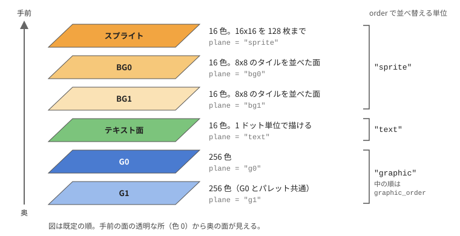
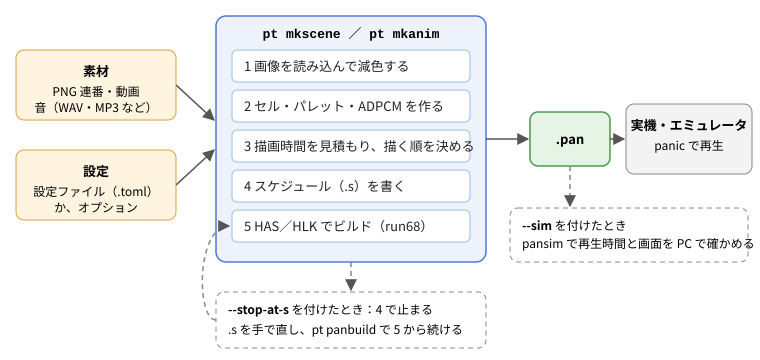

# panic データ制作ツール 使い方

PC（Windows・Linux・mac）上の素材（画像の連番・動画・音声）から、X68000 用アニメーション再生システム ぱにっく（panic.x V1.38.01）の
データ（.pan）を作るツール群の使い方です。目標の対象機は **MPU 10MHz の X68000** です。再生は実機でもエミュレータでもかまいません。

---

## 1. できること

- 画像（PNG・JPEG・GIF など）の連番、動画 1 本、またはアニメーション GIF から、.pan を 1 コマンドで作る（`mkanim.py`）。
- グラフィック 0／1、テキスト面、スプライト、BG 面を重ねたアニメを、設定ファイル（TOML）から作る（`mkscene.py`）。
  X68000 の画面は次の面が重なってできていて、層（`[[layer]]`）ごとにどの面に置くかを `plane` で選びます。

  

  - 枚数の違う層どうしのタイミング合わせ、表示する順番と表示時間の指定、重なり順の変更。
  - 永久ループ＋キーで終了、音（ADPCM）の再生と鳴らし直し。
  - FM 音源の曲と効果音（Z-MUSIC ver2 の MML から。[FM 音源](manual/fm.md)）。
  - 10MHz で間に合うように、描画時間を見積もって符号化を調整し、必要なら分割して描く・コマを飛ばす。
- 素材の変換だけをツールに任せ、スケジュール（.s）を自分で書いて作る（`mkparts.py`＋`buildPan.py`。[手で作る（mkparts＋buildPan）](manual/mkparts.md)）。
- 自動で作った .s で止めて人が手直しし、続きから .pan を作る（`buildPan.py`）。
- .pan を PC 上で実行して、再生時間と画面を確かめる（`pansim.py`）。

---

## 2. 準備

**`setup.bat` をダブルクリック**すると、必要なものを自動でダウンロードして、このフォルダの中に置きます
（Windows には何もインストールしません。最初の 1 回だけインターネット接続が必要、全部で約 130MB）。
何を取るかと版・SHA-256 は `tools/setup/deps.json` にあります。詳しくは一番上の README.md。

| もの                                     | 用途                                               | 置く場所                      |
| ---------------------------------------- | -------------------------------------------------- | ----------------------------- |
| Python 3.13（埋め込み版）、Pillow、numpy | ツール本体                                         | `runtime/python/`             |
| ffmpeg                                   | 動画の切り出し、音声の読み込み                     | `runtime/ffmpeg/`             |
| run68x                                   | X68000 のプログラム（HAS／HLK）を Windows で動かす | `runtime/run68/`              |
| HAS060X、HLK evolution                   | X68000 のアセンブラとリンカ                        | `x68/bin/`                    |
| panic.x、sch.h                           | panic の再生器とマクロ                             | `x68/`                        |
| Z-MUSIC ver2.08、そのマニュアル          | FM 音源のドライバ（[FM 音源](manual/fm.md)）       | `x68/zmusic/`、`docs/zmusic/` |

- `setup.bat --samples` でサンプルの素材（テストアニメの PNG、Big Buck Bunny 10 秒）も用意します。
  Big Buck Bunny は `--samples` のときだけダウンロードします（CC BY 3.0。入手元とクレジットは README.md の表）。
- ツールは `pt.bat` から動かします：`pt mkscene 設定.toml`（`pt` だけで一覧）。このマニュアルのコマンドの例も、すべて `pt` の形で書いてあります。
  `pt` は、setup.bat が用意した Python（`runtime\python\`）で `tools\<名前>.py` を動かします。

> **自分の（インストール済みの）Python を使う場合の注意**
>
> - `python tools\mkanim.py …` のように `python` で直接動かすと、`runtime\python\` ではなく、パソコンにインストールしてある Python が使われます。
>   `pt` も、`runtime\python\` が無いとき（setup.bat をまだ実行していないとき）は、インストールしてある Python を使います。
> - その場合は、その Python（3.11 以上）に、ツールが使うパッケージ（Pillow、numpy）を入れておいてください：`pip install -r requirements.txt`。
>   入っていないと、ツールはエラーで止まります。
> - ffmpeg・run68x・アセンブラなどは、`python tools\setup\setup.py` で用意できます（setup.bat と同じ。Python は入れません）。
> - `python tools\〇〇.py 引数…` は `pt 〇〇 引数…` と同じ動きです（使う Python だけが違います）。

- 外部のプログラムの場所は、環境変数 `FFMPEG`、`RUN68`、`PANTOOL_HAS`、`PANTOOL_HLK`、`PANTOOL_ZMUSIC`（ZMUSIC.X）で変えられます（`tools/paths.py`）。
- 再生の確認には、X68000 の実機かエミュレータが要ります（含みません）。エミュレータでは `x68/` を X68000 のドライブとして共有します
  （ホストのフォルダを共有する機能。WindrvXM など。以下の例では H: ドライブ）。実機へは .pan を写して使います。

### Linux・mac で使う

Linux と mac でも使えます。setup.bat の代わりに `setup.sh`、pt.bat の代わりに `pt` を使います。
ただし、Windows 用のもの（Python の埋め込み版、ffmpeg、run68x）は自動では入らないので、自分で用意します。
Linux（Ubuntu 22.04）では、Windows と同じ .pan ができることを確かめています。mac は確かめていません。

1. **Python 3.11 以上と、そのパッケージ**を用意します。
   ```
   python3 --version                       （3.11 以上か確かめる）
   python3 -m pip install -r requirements.txt
   ```
   `python3` が 3.11 より古いときは、新しい Python の場所を環境変数 `PYTHON` に書きます（例 `export PYTHON=/usr/local/bin/python3.12`）。
2. **ffmpeg**（音声・動画を使うときだけ）：Linux は `sudo apt install ffmpeg` など、mac は `brew install ffmpeg`。
3. **run68**（X68000 のプログラムを動かすもの）をソースから作り、PATH の通った所に置きます（または環境変数 `RUN68` に場所を書く）。
   - Linux：**run68x**（https://github.com/kg68k/run68x ）
     ```
     git clone https://github.com/kg68k/run68x.git
     cd run68x
     cmake -B build -DCMAKE_BUILD_TYPE=Release
     cmake --build build                     （build/run68 ができる）
     ```
     gcc が古いと（Ubuntu 22.04 の gcc 11 など）、警告でビルドが止まることがあります。そのときは CMakeLists.txt の `-Werror` を消してから作り直します。
   - mac：**run68mac**（https://github.com/yunkya2/run68mac ）
     ```
     brew install cmake libiconv
     git clone https://github.com/yunkya2/run68mac.git
     cd run68mac && mkdir build && cd build
     cmake .. && make && make install        （/usr/local/bin/run68 に入る。sudo が要ることもある）
     ```
     run68x を mac で作れれば（作り方は Linux と同じ）、それを使ってもかまいません（確かめていません）。
4. このフォルダで準備します（アセンブラ・リンカ・panic.x・Z-MUSIC をダウンロードします）。
   ```
   ./setup.sh                              （サンプルも用意するなら ./setup.sh --samples）
   ```
   最後に「そろいました」と出れば完了です。足りないものがあれば、入れ方を表示します。
   Linux・mac では、アセンブラとリンカに **HAS v3.09（x68/bin/has.x）** と **HLK v3.01（x68/bin/hlk.x）** を使います
   （retropc.net から。転載可）。run68x でも run68mac でも動き、Windows で使う HAS060X・HLK evolution と同じ .pan ができます
   （run68mac は HAS060X・HLK evolution を動かせないため、こちらにしています）。
5. ツールは `./pt` で動かします。パスの区切りは `/` です。
   ```
   ./pt mkanim samples/anim2 test1 --fps 12 --diff
   ```

このマニュアルのコマンドの例は Windows の書き方（`pt …`、`\` 区切り）です。Linux・mac では `./pt …`、`/` 区切りに読み替えてください。

### フォルダ

```
setup.bat  pt.bat  準備と、ツールの入口（Linux・mac は setup.sh と pt）
tools/        ツール（Python）。tools/setup/ に準備の仕組み
x68/          X68000 側のファイル。エミュレータではここを共有する
  anim/<名前>/  作った .pan の既定の出力先
  bin/          HAS060X／HLK evolution（setup が置く）
  lib/          .s から .include する 68000 のルーチン（VWAIT、FM 音源など。docs/LIBRARY.md）
  zmusic/       Z-MUSIC ver2（setup が置く。docs/manual/fm.md）
  work/         ビルドの作業フォルダ（自動で使う）
runtime/      setup がダウンロードした物（Python、ffmpeg、run68）
samples/      サンプルの素材と設定ファイル
docs/         このマニュアル（MANUAL.md、manual/ にツールごとの説明、img/ に図）、LIBRARY.md（ライブラリと VWAIT）。docs/panic/ に panic の付属ドキュメント（setup が PAN13801.LZH から置く。Shift-JIS）
```

- ビルド（run68 で動かす HAS／HLK）は短いパスの作業フォルダで行います。run68 上の HAS／HLK は長いパスを扱えないため、
  `x68/work` のパスが 60 文字を超えるときは `%LOCALAPPDATA%\pck\work` などを使います。
  それも長いときは、環境変数 `PANTOOL_WORK` に短いフォルダ（例 `C:\ptwork`）を指定してください。

コマンドは `panicCreationKit` のフォルダ（setup.bat のあるフォルダ）で実行します（例：`pt mkanim …`）。

---

## 3. まず試す

サンプルの素材（PNG）は git には入っていないので、`setup.bat --samples` で用意するか、次のように作ります。

```
pt make_test_anim samples/anim2 32 --static     # 回る円（背景は止まっている）32 コマ
pt make_test_anim --layers                      # samples/layer1/ の層のサンプル（背景・キャラ・字幕・スプライトなど）
```

### PNG 連番 1 つから作る

```
pt mkanim samples/anim2 test1 --fps 12 --diff
```

`x68/anim/test1/test1.pan` ができます。X68000 の上で（`x68/` を H: に共有しているとして）：

```
H:\>panic anim\test1\test1.pan
```

### 動画から作る（音も動画から取る）

```
pt mkanim 動画.mp4 video1 --fps 12 --diff --start 10 --duration 5
```

### 層を重ねる（設定ファイル）

```
pt mkscene samples/layer1/scene4.toml
```

サンプルの設定ファイル（`samples/layer1/*.toml`、`samples/buf4/*.toml`）に、項目の説明をコメントで書いてあります。

---

## 4. 作業の流れ

作り方は 2 通りあります。

|                    | 自動で作る（mkanim・mkscene）                                              | 手で作る（mkparts＋buildPan）                                                                     |
| ------------------ | -------------------------------------------------------------------------- | ------------------------------------------------------------------------------------------------- |
| ツールがすること   | 素材の変換から、描く順・分割描画・差分・コマの間引き・ループの展開まで全部 | 素材の変換（セル・パレット・ADPCM）と、ビルドだけ                                                 |
| 自分ですること     | 素材を用意して、設定ファイル（またはオプション）を書く                     | スケジュール（.s）を書く。何を・いつ・どこに描くかを全部自分で決める                              |
| 向いているもの     | 動画や連番のアニメを、10MHz で間に合うように手早く                         | タイトル画面、キーで分岐する作品、紙芝居、演出を 1 コマずつ決めたいもの。panic の命令を全部使える |
| 10MHz で間に合うか | ツールが見積もって合わせる                                                 | 自分で確かめる（mkparts が描く時間の目安を表示し、pansim で確かめられる）                         |
| 説明               | 4.1、[mkanim](manual/mkanim.md)、[mkscene](manual/mkscene.md)              | **[手で作る（mkparts＋buildPan）](manual/mkparts.md)**                                            |

### 4.1 自動で作る（mkanim・mkscene）



1. **素材を用意する**：256x256 の画像（PNG・JPEG など）の連番（ファイル名の順がコマの順）、または動画。音は WAV／MP3 など。

   大きさが違う画像は、縦横比を保って縮小し、中央の 256x256 を使います（`fit`）。
2. **設定ファイルを書く**（mkscene）か、**オプションを並べる**（mkanim）。
3. **作る**：`pt mkscene 設定.toml`。終わりに、描画が間に合うかの見積もりと警告が出ます（→ 7 章）。
4. **確かめる**：必要なら `--sim` を付けて pansim で再生時間と画面を確認。
5. **実機・エミュレータで見る**：`panic <出力先>\<名前>.pan`。`--timelog` で作ると、実際の再生時間が time.txt に書かれます。

### 4.2 自動で作った .s に手を入れる

自動で作ったものを土台にして、少しだけ手を入れたいときの方法です。

```
pt mkscene 設定.toml --stop-at-s      # 素材と .s を作って止める
（<出力先>/build/<名前>.s を編集する。Shift-JIS・CRLF。最後の .include <名前>_d.h は消さない）
pt buildPan <出力先>\build\<名前>.s                # 続きから .pan を作る（.pan は <出力先> にできる）
```

自動で作った .s は、分割描画や差分のセルが細かく並び、くり返しも全部の周を書き並べるので、長くなります（[mkscene](manual/mkscene.md) の 6 章の「.s が大きくなること」）。
人が読んで直すのには向きません。
最初から自分で組み立てたいときは、[手で作る（mkparts＋buildPan）](manual/mkparts.md)を使ってください。素材の足し方も、そのページの 6 章と同じです。

---

## 5. ツールごとの説明

| 説明                                               | 中身                                                                                                                              |
| -------------------------------------------------- | --------------------------------------------------------------------------------------------------------------------------------- |
| [mkanim](manual/mkanim.md)                         | 画像の連番・動画・アニメーション GIF から .pan を 1 コマンドで作る（重ね合わせ無し）                                              |
| [mkscene](manual/mkscene.md)                       | 層を重ねたアニメを設定ファイルから作る。全体と層の項目、速さ・順番・ループ、仕組み（見積もり・入れ物・分割描画・差分）、4 面      |
| [画像の読み込み方](manual/image.md)                | 縮小・切り抜き・縦横比、透明色（自動判定も）、減色の前処理（ふち・かぶり取り・むら・孤立ドット）。mkanim・mkscene・mkparts で共通 |
| [手で作る（mkparts＋buildPan）](manual/mkparts.md) | 素材とひな形を作り、.s を自分で書いて .pan にする                                                                                 |
| [FM 音源](manual/fm.md)                            | Z-MUSIC ver2 の曲・効果音を鳴らす（MML の書き方、mkanim・mkscene・手で書く .s で使う）                                            |
| [ベンチ動画（mkbench）](manual/mkbench.md)         | 描画の速さを数える .pan を作る                                                                                                    |
| [pansim とそのほかのツール](manual/tools.md)       | .pan を PC 上で確かめる pansim、png2cel・adpcm などの小さなツール、セルの正解データ                                               |

---

## 6. 出力されるファイル

出力先（既定 `x68/anim/<名前>/`）には、できあがりの .pan だけを置き、作る途中のファイルはその中の `build/` にまとめます。

| ファイル                                                | 中身                                        |
| ------------------------------------------------------- | ------------------------------------------- |
| `<名前>.pan`                                            | できあがりのデータ                          |
| `build/<名前>.s`                                        | スケジュールのソース（手直しできる）        |
| `build/<名前>_d.h`                                      | 素材のラベル（buildPan が毎回作る）         |
| `build/<名前>.json`                                     | 素材の一覧と設定の記録（buildPan が使う）   |
| `build/cNNN.cel`、`sNNN.spr`、`pal.dat`、`pcm.dat` など | セル、スプライト、パレット、音              |
| `build/frames_<層>/`                                    | 動画・アニメーション GIF から切り出した PNG |
| `build/reduced/<層>/<番号>.png`                         | 減色した後の画像（下の注）                  |
| `build/time.txt`                                        | `--timelog` で記録した再生時間（下の注）    |

- `build/reduced/` には、層ごとに、減色した後の画像を PNG で置きます（X68000 で表示される色。透明は透明）。番号は元の画像の番号
  （ファイル名の順、0 から。動画は切り出したコマの順）で、表示に使う画像だけを置きます。作り直すたびに書き直します。
- 出力先に、このツールが作ったものでないかもしれないファイル（cNNN.cel など）があると、消さないように止めます。
- エミュレータで見るには、出力先を `x68/` の中にするか、.pan を x68 の中へ写します（実機では .pan を写す。`build/` は要りません）。
- mkanim の `--split` では、分けた .pan（`<名前>00.pan` …）と、続けて再生するための `play.bat` を出力先に置きます。
- `--timelog` の time.txt は、出力先が x68 の中なら `<出力先>\build\time.txt`（H:\ で実行）、外なら panic を実行したフォルダの `<名前>.txt` です。
  中身は `T0=… T1=… EXPECT=…`（16 進、1/100 秒。T1−T0 が実際の再生時間、EXPECT が予定）。

---

## 7. 10MHz で滑らかに再生するコツ

- **描画時間の目安（10MHz）**：256x256 を全部描き直すと 1 枚 約 55〜67 ms。待ち 1 カウントは 18 ms。
  G0 と G1 が両方とも毎コマ大きく変わるなら、1 回の切り替えに 130 ms 前後（7fps くらい）が要ります。
- **差分（diff）**：動きが一部だけの絵（キャラなど）では描く時間がほぼ半分になります。背景の写真など毎コマ全体が変わる絵では効きません。
- **4 面（buffers = 4、既定）**：同じ絵のくり返しや、時間の偏りに強くなります。
- **作ったときの警告を見る**：
  - 「層 bg は描画が間に合わず、予定の切り替え N 回のうち M 回を飛ばします（6 枚のうち表示されるのは 2 枚…）」
    → その層をゆっくりにする（loop_ratio を大きく／fps を下げる）、ほかの層の fps を下げる、絵を単純にする。
  - 「間に合わないので飛ばしたコマ」「分割して描いた回数」は、多少あっても問題ありません（全体の時間は保たれる）。
  - 「遅れて描くコマ（処理落ち）」は、再生時間が延びます。
- **fps**：55.46 を割り切れる値（11.1、13.9、18.5 など）にすると、コマの長さがそろいます。

---

## 8. 制限

| もの                            | 上限                                                                                                        |
| ------------------------------- | ----------------------------------------------------------------------------------------------------------- |
| 出力名                          | 英数字 8 文字（--split のときは 6 文字）                                                                    |
| 1 層のコマ（画像）の数          | 1000                                                                                                        |
| グラフィックの色                | G0・G1 合わせて黒＋黒以外 254 色（パレット共通）                                                            |
| テキスト面・スプライト・BG の色 | 層ごとに黒＋14 色                                                                                           |
| スプライト                      | 同時に 128 枚、パターン（16x16）256 個まで（BG を使うとその分減る）。スプライトと BG の層は合わせて 15 まで |
| BG のタイル                     | 8x8 で 256 種類まで                                                                                         |
| .pan の大きさ                   | panic.x は丸ごと読み込む。RAM 10MB で 7.9MB は可、9.4MB は「メモリが不足」（8MB を超えると警告）            |
| FM 音源の効果音                 | 1 つ 8 トラックまで。mkscene の `[[se]]` は 9 個まで                                                        |
| 長い素材の連続再生（--split）   | つなぎ目ごとに約 1.2 秒、画面が黒・無音になる                                                               |

**色の数について**：パレットの 0 番は透明、1 番は黒に決めてあり、残りの番号に絵の色を入れます。
そのため、使える色は透明と黒のほかに、グラフィックで 254 色、テキスト面・スプライト・BG で 14 色です（黒を使わない絵でも、1 番は黒のままです）。
これは panic.x の決まりに合わせたものです。パレットを設定する命令（`GPAL`・`TPAL`）は、0 番を透明にし、
1 番には輝度ビットを立てて「透明にならない黒」として書き込みます。当時の bpica.x・bpic.x が作るパレットも同じ形です。

---

## 9. 困ったとき

- エラーは「エラー：…」の 1〜数行で表示します（ファイルが無い、設定の書き間違い、値の範囲など）。
- 詳しい情報（Python のトレースバック）が要るときは、環境変数 `PANTOOL_DEBUG=1` を付けて実行します。
  PowerShell なら `$env:PANTOOL_DEBUG=1`、コマンドプロンプトなら `set PANTOOL_DEBUG=1`。
- 「run68 が見つかりません」「has060x.x が見つかりません」「ffmpeg…が見つかりません」→ `setup.bat` を実行します（`setup.bat --check` でそろっているか確かめられます）。
- 「ビルドの作業フォルダに使える短いパスがありません」→ 環境変数 `PANTOOL_WORK` に短いフォルダを指定します。
- 「永久ループにできません」→ 1 周の中で各層が整数回ループしているか（[mkscene](manual/mkscene.md) の 3 章）、描画が極端に間に合っていないかを確かめます。
- `panic` がファイルを見つけられない → 実行しているドライブ・フォルダ（`cd \`）と、`x68/` の共有先を確かめます。

panic そのものの説明（命令、sch.h、a_enc 形式など）は、setup が置く `docs/panic/` の付属ドキュメント（Shift-JIS）にあります。
