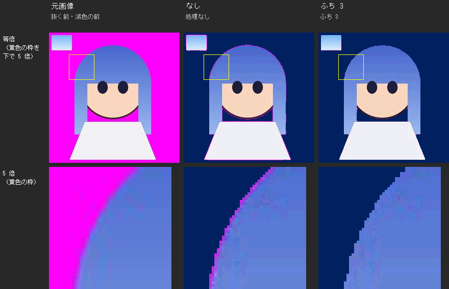
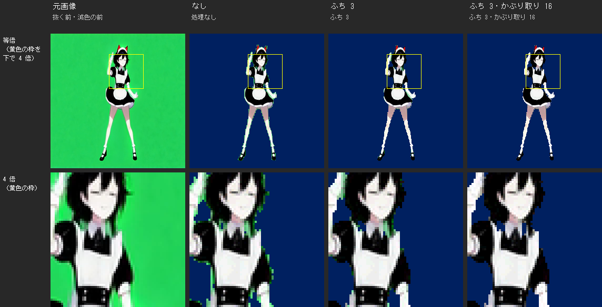
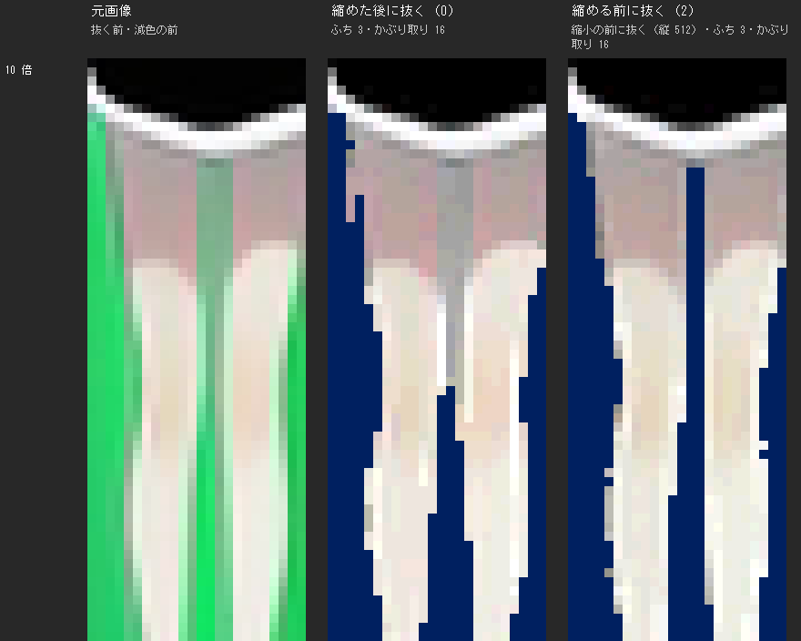
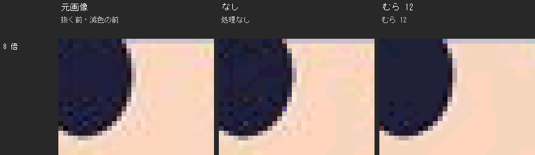
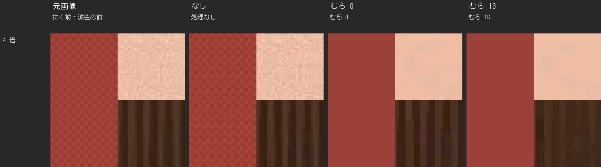

# 画像の読み込み方と減色の前処理（mkanim・mkscene・mkparts 共通）

[← 使い方（MANUAL）へ](../MANUAL.md)

ここに書く設定は、mkscene では設定ファイルの全体（全層の既定）と層（`[[layer]]`）の両方に書けます（層の方が優先）。
mkanim・mkparts では、同じ名前のオプション（`transparent_fringe` なら `--transparent-fringe`）で指定します。

## 1. 大きさと色

- 読める画像の形式は PNG・JPEG・BMP・GIF・TIFF・WebP です。連番は、フォルダの中のこれらの画像をファイル名の順に並べます。
- アニメーション GIF（アニメーション PNG・WebP も）は、動画と同じように 1 つのファイルで書けます。`fps` に合わせてコマを取り出し
  （GIF の各コマの表示時間を守る）、`start`・`duration` も動画と同じに使えます。音はありません。
- **画像がもともと持っている透明はそのまま透明にします**：PNG のアルファ、GIF の透明色、アニメーション GIF の透明な所。
  半透明（アルファ 1〜254）は、アルファ 128 以上を不透明、128 未満を透明にします（X68000 の透明は「透ける・透けない」の 2 つだけのため。
  縮めるときは、透明な所の色が混ざらないように計算します）。透明色（2 章）を指定したときは、その色も合わせて透明になります。
- JPEG には透明が無いので、背景を抜くには透明色（2 章）を指定します。
- 既定では、256x256 の画像は縮小も切り抜きもしません。色を X68000 の色（RGB 各 5 ビット）に丸め、アルファ 128 未満を透明（色 0）にするだけです。
  色の数がパレットに入らないときだけ減色します（グラフィックは G0・G1 合わせて黒＋黒以外 254 色、テキスト・スプライト・BG は層ごとに黒＋14 色）。
- `aspect = true`：X68000 の 256x256 モードのドットは縦 2：横 3 の横長なので、横を 2/3 に縮めて正しい形に見えるようにする。
  `pixel_aspect` で 1 ドットの横÷縦を変えられます（既定 1.5）。
- `fit = "pad"`（全体を収めて余白は透明）／`"crop"`（埋めてはみ出しを切る）。既定は `aspect` なら pad、なしなら crop。

## 2. 透明色

- `transparent = "#FF00FF"`：その色を透明にします。`"corner"` で各画像の左上 (0,0) の色（当時の方法）。`";"` 区切りで複数。
  `transparent_tolerance = N` で RGB 各 N までの差を許します（動画など、背景の色がゆれる素材）。
- `transparent = "auto"`：背景色（透明にする色）を自動で決めます。層のコマ（動画なら切り出したコマ）から 16 枚ほどを選び、
  画像のまわり（ふち）でいちばん多い色を背景色にします。`transparent_tolerance` を書いていなければ、許す差も背景の色のゆれから決めます
  （ゆれの無い絵は 0）。決めた色と許す差は画面に表示されるので、`transparent = "#RRGGBB"` として書き写すこともできます。
  背景が 1 色でない素材（背景の絵、実写、まわりに 2 色以上が目立つもの）や、画像のほとんどが背景色に近い素材では、理由を表示して止まります。
  画像のまわりがもともと透明（PNG のアルファ）なら、透明色は使いません。
- 背景の色は素材によって少しずつ違います（グリーンバックの緑が `#00FF00` とは限らない）。色を自分で書くときは、画像を開いて背景の色を調べ、
  動画なら `transparent_tolerance = 30`〜`40` くらいから試し、背景の中に点が残るなら少しずつ上げてください
  （背景の点は、色のゆれが許す差を超えた所です）。

## 3. 減色の前処理

`transparent_prescale` のほかは、既定ではしません。
下の見本の画像は、左端が元画像（透明色を抜く前・減色の前）、ほかの列がそれぞれの設定で作った画面です。透明になった所は紺で表しています。

### 3.1 ふち（transparent_fringe・transparent_cut）

`transparent_fringe = 3`：透明にしたドットから 3 ドット以内（ふち）の、透明色が混ざった色（アンチエイリアスや JPEG のにじみ。
マゼンタの背景ならピンクのふち）を直します。ふちのドットが「近くの内側の色と透明色を混ぜた色」に近いときだけ、
透明色の混ざり具合が `transparent_cut`（既定 0.5）以上なら透明、少なければ内側の色にします。

- 混ぜた色から離れた色（黒い輪郭線など）と、ふちの幅より細い線は、そのまま残します。
- 透明色に似た色（マゼンタの背景のピンクの服など）が輪郭の近くにある絵では、そこが透明になることがあります。
- ふちがきれいなドット絵には要りません（輪郭の隣の影の色が変わることがあります）。

### 3.2 かぶり取り（transparent_despill）

`transparent_despill = true`：透明にしたドットから 4 ドット以内（数で幅を指定。0〜64）の色の「かぶり取り」をします。
透明色が混ざった色（グリーンバックの緑かぶり、動きのブレで奥まで混ざった所、細い線）から透明色の分を差し引き、
元の色を推測して戻します（色みだけでなく明るさも戻ります）。`transparent_fringe` と一緒に使うのがおすすめです。

- 元の色の手がかりには、幅より奥にある近くの色を使うので、奥まで同じ色の物（マゼンタの背景のピンクの服など）は変わりません。
- 透明色の混ざり具合が `transparent_cut`（既定 0.5）以上のドットは透明にします（脚の間の細い隙間など、背景が見えている所）。
- 幅より小さな、透明色に似た色の物（グリーンバックの前の黄緑の小物など）は、色が変わったり透明になったりします。
- 素材に透明色に似た色の物が無ければ、幅を広く（16 など）すると、脚の間のような、ふちから離れた所のかぶりも取れます。

### 3.3 縮める前に抜く（transparent_prescale）

動画の層で透明色を指定したときは、256x256 に縮める前の大きい絵で透明色を抜いてから縮めます。
縮めると 1 ドットより細くなる隙間（脚の間など）が、背景と混ざらずに透明で残ります。

`transparent_prescale = N` で、透明色を抜くときの大きさを決めます。

| 値          | 透明色を抜く大きさ                                         |
| ----------- | ---------------------------------------------------------- |
| `2`（既定） | 縦を 256 の 2 倍（512 ドット）に縮めた絵。横は縦横比を保つ |
| `N`（3〜8） | 縦を 256 の N 倍に縮めた絵                                 |
| `1`         | 動画の元の大きさのまま                                     |
| `0`         | 256x256 に縮めた後（縮める前には抜かない）                 |

- 元の大きさのままではなく、いったん縦 256 の N 倍にそろえるのは、次の 2 つのためです。見た目は、元の大きさで抜くのとほとんど変わりません。
  - **速さ**：処理の時間は絵のドットの数にほぼ比例します。フル HD や 4K の動画を元の大きさで処理すると、1 コマに数秒かかります。
  - **幅の設定をそろえる**：`transparent_fringe`・`transparent_despill` の幅は、透明色を抜く絵の上のドットで数えます。
    大きさをそろえておけば、元の動画の大きさによらず、同じ幅の設定が同じように効きます（既定の `2` なら、3 ドットは仕上がりの約 1.5 ドット）。
- 2 倍あれば、仕上がりの半ドットほどの細い隙間も見分けられます。細い線がとても多い素材などで、時間をかけても元の大きさで抜きたいときは `1` にします。
- 元の動画が、その大きさより小さいときは、元の大きさのまま抜きます（拡大はしません）。
- `0` より遅くなります（既定の `2` で 1 コマ 0.1〜0.3 秒ほど増える。大きくするほど遅い）。
- 画像の連番とアニメーション GIF は、いつも元の大きさのまま透明色を抜きます。

### 3.4 むら（flatten）

`flatten = 12`：減色の前に、単色の中の細かいむら（JPEG のむらなど）を均します。RGB 各の差が 12 以内の近くのドットだけで
平均するので、輪郭は混ざらず、なだらかなグラデーションも保たれます。むらに取られていたパレットの色が、ほかの所に回ります。
動画では、前のコマとの差分が小さくなり、データも小さくなります。

値を大きくすると、細かい模様や質感（布の織り目、肌や髪の質感）も平らになります。

### 3.5 孤立ドット（despeckle）

`despeckle = true`：減色の後に、まわりと色の近い（RGB 各 24 以内）1 ドットだけの点を、まわりの色にします。数で差を指定できます。

- ドット絵の目のハイライトのような、わざと置いた 1 ドットも、まわりと色が近いと消えます。
- ディザ（`dither = "ordered"`／`"fs"`）の模様も点として消してしまうので、ディザと一緒には使わないでください。
- 透明色を指定しているときは、透明に囲まれた小さな点（1〜2 ドット。背景の色のゆれが許す差を少し超えて残った点）も、
  透明色との差が `transparent_tolerance` の 1.5 倍以内なら透明にします（`transparent_tolerance = 0` のときはしません）。
  `transparent_despill` を付けていれば、こうした点はたいていすでに消えています。

### 3.6 素材ごとの目安

| 素材                                                    | 付けるもの                                                                     | 付けない方がよいもの                   |
| ------------------------------------------------------- | ------------------------------------------------------------------------------ | -------------------------------------- |
| グリーンバック・マゼンタの背景の写真や動画（JPEG など） | `transparent = "auto"`、`transparent_fringe = 3`、`transparent_despill = true` | 透明色に似た色の小物があるなら despill |
| 実写・動画で、データを小さくしたいとき                  | `flatten = 8`〜`12`（`stabilize` と合わせるとさらに小さくなる）                | 質感を残したいなら flatten             |
| ドット絵（ふちがきれいなもの）                          | なし                                                                           | fringe・despill・flatten・despeckle    |
| なめらかなグラデーションの絵                            | なし（色が足りなければ `dither = "ordered"`）                                  | despeckle                              |
