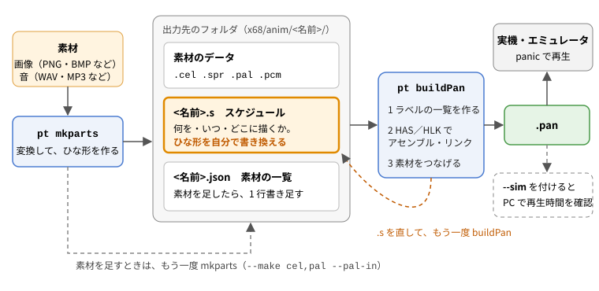

# 手で作る（mkparts＋buildPan）

[← 使い方（MANUAL）へ](../MANUAL.md)

ツールには素材の変換とビルドだけを任せ、**何を・いつ・どこに描くか（スケジュール）は自分で書く**作り方です。
自動で作る mkanim・mkscene と違い、ツールは描く順や待ちを勝手に変えません。.s に書いたとおりに再生されます。
panic の命令（キーでの分岐、くり返し、サブルーチン、自分で書いた 68000 のルーチンなど）を、すべて自由に使えます。



## 1. ひととおりの流れ

例：タイトルの画像 1 枚、アニメのコマを入れたフォルダ、音 1 つから作る場合です。

```
pt mkparts title.png frames bgm.wav --name demo --fps 8       ① 素材とひな形を作る
（x68\anim\demo\build\demo.s をテキストエディタで書き換える）  ② スケジュールを書く
pt buildPan x68\anim\demo --sim                              ③ .pan を作り、PC で再生時間を確かめる
H:\>panic anim\demo\demo.pan                                  ④ 実機・エミュレータで見る
```

- ① の mkparts は、素材を panic の形に変換し、「画像を順に表示して音を鳴らす」だけのひな形の .s と、素材の一覧（.json）を作ります（2 章）。
- ② で .s を自由に書き換えます（4 章、5 章）。素材が足りなくなったら、mkparts でもう一度変換して足します（6 章）。
- ③ の buildPan は、.s をアセンブルして、素材をつなげた .pan を作ります（7 章）。
- ②〜④ をくり返して仕上げます。

## 2. mkparts：素材とひな形を作る

```
pt mkparts <画像・音声・画像のフォルダ・MML…> --name 名前 [--make cel,pal,pcm,zmd,s] [--se 効果音の MML] [オプション]
```

画像（png、bmp、jpg、gif など）、音声（wav、mp3、ogg、flac など）、画像の入ったフォルダ（名前順）、FM 音源の MML（Z-MUSIC ver2 の .zms／.opm、または .zmd）を、いくつでも並べられます。
出力先は `x68/anim/<名前>/`（`--out` で変えられる）です。素材・.s・.json はその中の `build/` に作り、buildPan が .pan を出力先に作ります。

| 作るもの（`--make`） | ファイル                            | 中身                                                                                         |
| -------------------- | ----------------------------------- | -------------------------------------------------------------------------------------------- |
| `cel`                | `<画像>.cel`（スプライトは `.spr`） | 選んだ面（`--plane`）のセル。下の表                                                          |
| `pal`                | `<名前>.pal`                        | パレット（全部の画像で共通。`--pal-each` で画像ごと、`--pal-in` で既存のパレットに色を足す） |
| `pcm`                | `<音声>.pcm`                        | ADPCM（15.625kHz）                                                                           |
| `zmd`                | `<MML>.zmd`、`<MML>.zse`、`.zmv`    | FM 音源の曲。`--se` で選んだ MML は効果音と音色の表（[FM 音源](fm.md)）                      |
| `s`                  | `<名前>.s`、`<名前>.json`           | ひな形のスケジュールと、素材の一覧。.s が使う素材も作る                                      |

- 既定は全部作ります。例：`--make cel,pal` でセルとパレットだけ。
- `--plane` で、どの面に使う形にするかを選びます。面ごとにセルの形式・色の数・パレット・命令が違います。

  | `--plane`          | セル                                                                                     | 色とパレット                                                | ひな形の命令                         |
  | ------------------ | ---------------------------------------------------------------------------------------- | ----------------------------------------------------------- | ------------------------------------ |
  | `g0`（既定）、`g1` | a_enc（256x256、1 枚まるごと。bpica.x と同じ形）                                         | 256 色（G0・G1 で共通）、`GPAL`                             | `DRW0`／`DRW1` と `SCL0`／`SCL1`     |
  | `text`             | 高速テキスト（TDRW の code #2、4 プレーン）                                              | 16 色（34 バイト）、`TPAL 0`                                | `DRWT` と `SCLT`                     |
  | `sprite`           | スプライトのセル（bpic -s と同じ形。透明でない所を 16 ドット単位で切り出し、位置も入る） | 16 色（34 バイト）、`TPAL <番号>`（`--sprite-pal`、既定 1） | `SPCG` で登録、`SPOF`／`SPON` で表示 |

  16 色の面は、黒＋14 色に減色します（理由は [MANUAL](../MANUAL.md) の 8 章の「色の数について」）。スプライトは 1 枚 128 キャラ（16x16）、全部で 256 キャラまでです。
- 変換したセルごとに、**10MHz で描くのにかかる時間の見積もり**を表示します（例：「セル title.cel：592 バイト、描く時間の見積もり 47.5 ms」）。
  待ちの長さを決めるときの目安にします（8 章）。`--clock` で別のクロックの値にできます。
- ファイル名は Human68k に合わせて英数字 8 文字までに縮めます（重なるときは番号を付ける）。
- すでに .s があるときは上書きしません（手直しを消さないため）。ただし **`--make` に `s` を入れると .json は作り直します**。
  .json に手で書き足した後は、`--make` に `s` を入れないでください（6 章）。
- `--build` を付けると、ひな形のまますぐに .pan も作ります。
- 画像のオプション（`--dither`、`--fast`、`--aspect`、`--fit`、`--transparent`、`--transparent-fringe`、`--transparent-despill`、`--flatten`、`--despeckle`）、音のオプション（`--gain`、`--start`、`--duration`）は mkanim と同じです（[mkanim](mkanim.md)）。
  `--fast` は、データが少し大きくなっても速く描ける形に符号化します（既定は bpica.x と同じ符号化）。
- ひな形の待ちは VWAIT（予定の時刻で待つ。[mkscene](mkscene.md) の 1 章の注）です。`--wait tmwa` で panic.x の TMWA にできます。`--fps` でひな形の切り替えの速さを決めます（既定 2）。
- 色の少ない画像なら、png2cel.py（bpica.x 互換）と同じセル・パレットになります。

## 3. フォルダの中身

出力先にはできあがりの .pan だけを置き、ほかはその中の `build/` にまとめます。

| ファイル               | 作るもの | 中身                                                                        |
| ---------------------- | -------- | --------------------------------------------------------------------------- |
| `<名前>.pan`           | buildPan | できあがり                                                                  |
| `build/<名前>.s`       | mkparts  | スケジュール。**自分で書き換える**。Shift-JIS・CRLF                         |
| `build/<名前>.json`    | mkparts  | 素材の一覧。.pan の後ろにつなげる素材と、そのラベル。素材を足したら書き足す |
| `build/*.cel`、`*.spr` | mkparts  | セル（グラフィック・テキスト）、スプライトのセル                            |
| `build/<名前>.pal`     | mkparts  | パレット                                                                    |
| `build/*.pcm`          | mkparts  | ADPCM                                                                       |
| `build/reduced/*.png`  | mkparts  | 減色した後の画像（X68000 で表示される色。透明は透明）。名前は素材の短い名前 |
| `build/<名前>_d.h`     | buildPan | 素材のラベル（.json から毎回作る。編集しない）                              |

.json の中身は次のような形です。`parts` の並びの順に、素材が .pan の後ろにつながります。

```
{
 "name": "demo",
 "clock": "10mhz",
 "parts": [
  ["pal", "demo.pal"],
  ["c_title", "title.cel"],
  ["c_c001", "c001.cel"],
  ["pcm_bgm", "bgm.pcm"]
 ]
}
```

（ほかの項目もありますが、そのままにしておきます。）

## 4. .s の書き方

**決まり**

- 文字コードは **Shift-JIS**、改行は **CRLF** で保存します（X68000 のアセンブラ HAS で読むため）。
- 命令は行の頭にタブを入れて書き、ラベル（飛び先の名前）は行の頭から書きます。`*` で始まる行と、命令の後ろにタブを空けて `*` から書いたものはコメントです。
- 命令の一覧と詳しい説明は、setup が置く `docs/panic/` の付属ドキュメント（sch.h、panic.doc など）にあります。

**骨組み**（mkparts のひな形もこの形です）

```
	.include	sch.h		* panic の命令（最初に必ず）
	.include	vwait.h		* VWAIT を使うとき

	TMON				* タイマーを動かす
	GPAL	pal			* パレット
	TMWA	1			* タイマーの基準
	VWINIT				* VWAIT の基準の時刻
	（ここに、描く・切り替える・待つ を並べる）
	DEND				* 画面を元に戻す
	EXIT				* 終わり（書き忘れると暴走する）

	.include	vwait.s		* VWAIT の本体（EXIT の後に置く）
	.include	<名前>_d.h	* 素材のラベル（いちばん最後に置く。消さない）
	.end
```

**素材のラベル**：.s の中では、素材を .json に書いたラベルで指します。mkparts が付けるラベルは次のとおりです。

| 素材               | ラベル                                                      |
| ------------------ | ----------------------------------------------------------- |
| グラフィックのセル | `c_<ファイル名>`（例：title.cel → `c_title`）               |
| テキスト面のセル   | `t_<ファイル名>`                                            |
| スプライトのセル   | `s_<ファイル名>`                                            |
| パレット           | `pal`                                                       |
| 音（ADPCM）        | `pcm_<ファイル名>`。終わりは `pcm_<ファイル名>_end`（自動） |

**よく使う命令**

| 命令                             | すること                                                                                               |
| -------------------------------- | ------------------------------------------------------------------------------------------------------ |
| `DRW0 x,y,セル`                  | G0 の (x,y) にセルを描く。x・y は 0 か 256（512x512 の面の 4 か所。[mkscene](mkscene.md) の 6 章の図） |
| `DRW1 x,y,セル`                  | G1 の (x,y) にセルを描く（x・y は DRW0 と同じ）                                                        |
| `SCL0 x,y`                       | G0 の、画面に出す所を (x,y) にする（スクロール）                                                       |
| `SCL1 x,y`                       | G1 の、画面に出す所を (x,y) にする（スクロール）                                                       |
| `DRWT x,y,セル`、`SCLT x,y`      | テキスト面に描く、テキスト面の画面に出す所                                                             |
| `GPAL pal`、`TPAL 番号,パレット` | グラフィックのパレット、テキスト（0）・スプライト（1〜15）のパレット                                   |
| `SPCG パレット,セル`             | スプライトのパターンを登録する（最初にまとめて）                                                       |
| `SPON セル`、`SPOF`              | スプライトを表示する、全部消す                                                                         |
| `PCMP 音,長さ`、`PCMS`           | 音を鳴らす（例：`PCMP pcm_bgm,pcm_bgm_end-pcm_bgm`）、止める                                           |
| `VWAIT n`                        | 予定の時刻を n カウント（1 カウント ≒ 18.03ms）進めて、そこまで待つ                                    |
| `VWINIT`                         | 予定の時刻を数え直す（最初と、キー待ちの後）                                                           |
| `TMWA n`                         | 前の TMWA から n カウント待つ（panic.x の待ち。遅れは取り戻さない）                                    |
| `BKEY キー,飛び先`               | キーが押されるまで待ち、そのキーなら飛ぶ（違えば次の行へ）。キーは `$20`（スペース）など               |
| `IKEY キー,飛び先`               | 待たずにキーを見て、押されていれば飛ぶ                                                                 |
| `GOTO 飛び先`                    | 飛ぶ（永久ループなど）                                                                                 |
| `SETR n` … `LOOP 飛び先`         | くり返し。`LOOP` は回数（D7）を 1 減らし、-1 になるまで飛び先へ戻る（`SETR 2` で 3 回）                |
| `GSUB 飛び先`、`RTSB`            | スケジュールの中のサブルーチンを呼ぶ、戻る                                                             |

**見えない所に描いて切り替える**：描いている途中の絵が見えないように、G0 の見えていない所（例：(256,0)）に `DRW0` で描き、
描き終わってから `SCL0` で切り替えます（mkparts のひな形はこの形で、(0,0) と (256,0) を交互に使います）。
仕組みは [mkscene](mkscene.md) の 6 章の図を見てください。

VWAIT の仕組みと、キー待ちと組み合わせるときの注意は [LIBRARY.md](../LIBRARY.md) にあります。

## 5. 例：タイトル → キー待ち → アニメを 3 回 → 終わり

1 章の mkparts で作った素材（`c_title`、`c_c001`、`c_c002`、`pcm_bgm`）を使う例です。

```
* demo.s : タイトル → キーを待つ → 音を鳴らしてアニメを 3 回 → 終わり

	.include	sch.h
	.include	vwait.h

	TMON				* タイマーを動かす（最初に 1 回）
	GPAL	pal			* グラフィックのパレット
	TMWA	1			* タイマーの基準

* ---- タイトル ----
	DRW0	0,0,c_title		* (0,0) にタイトルを描いて
	SCL0	0,0			* そこを表示する
	BKEY	$20,start		* キーが押されるまで待つ（どのキーでも次の行へ進む）
start:
	VWINIT				* キーで止めた後は、ここから時刻を数え直す
	PCMP	pcm_bgm,pcm_bgm_end-pcm_bgm	* 音を鳴らす

* ---- アニメを 3 回 ----
	SETR	2			* LOOP は D7 を 1 減らし、-1 になるまで戻る（2 → 3 回）
again:
	DRW0	256,0,c_c001		* 見えていない (256,0) に描いて
	SCL0	256,0			* 表示を切り替える
	VWAIT	7			* 7 カウント（約 126ms）ごと
	DRW0	0,0,c_c002
	SCL0	0,0
	VWAIT	7
	LOOP	again

	PCMS				* 音を止める
	DEND				* 画面を元に戻す
	EXIT				* 終わり（書き忘れると暴走する）

	.include	vwait.s		* VWAIT の本体（EXIT の後）
	.include	demo_d.h	* 素材のラベル（buildPan が作る。いちばん最後）
	.end
```

`pt buildPan x68\anim\demo\demo.s` で .pan になります。

## 6. 素材を足す

作っている途中で画像や音を足すときは、**同じ出力先に mkparts をもう一度動かし、.json に書き足します**。

```
pt mkparts frames2 --name demo --make cel,pal --pal-in x68\anim\demo\build\demo.pal
```

1. `--make` に `s` を入れません（.s と .json はそのまま）。出力先は `--name` が同じなら同じフォルダ（の `build/`）です（`--out` でも指定できる）。
2. グラフィックの画像は `--pal-in` で今のパレットを読み、足りない色を後ろに足します。今までの色の番号は変わらないので、
   前に作ったセルはそのまま使えます。パレットがいっぱい（256 色）のときはエラーになります。
3. できたファイルを `<名前>.json` の `parts` に書き足します。例：`["c_f010", "f010.cel"]`、`["pcm_se", "se.pcm"]`。
   ラベルは 4 章の表のとおりに付けます（音の終わりのラベル `pcm_se_end` は自動でできます）。
4. .s で使って、buildPan し直します。

**別の面の素材を足すとき**（例：グラフィックのアニメに、テキスト面の字幕を足す）は、パレットの形が違うので、`--name` を変えて別のパレットにします。

```
pt mkparts jimaku.png --name demot --out x68\anim\demo --plane text --make cel,pal
```

`demot.pal` と `jimaku.cel` ができるので、.json に `["tpal", "demot.pal"]`、`["t_jimaku", "jimaku.cel"]` を書き足し、
.s では `TPAL 0,tpal`、`DRWT 0,0,t_jimaku`、`SCLT 0,0` のように使います（ラベルの名前は自由です。.json と .s で同じにします）。

- 同じ名前のファイルがあると上書きします。
- 自分で用意したデータ（ほかのツールで作ったセルや、自分で作った表など）も、`build/` に置いて .json に書けば、同じようにラベルで使えます。

## 7. buildPan：.pan を作る

```
pt buildPan <名前>.s [--sim] [--clock 10]
```

- .s と同じフォルダに `<名前>.json` があると、次のことをします。
  1. .json から素材のラベルの一覧（`<名前>_d.h`）を作る。
  2. .s を HAS でアセンブルし、HLK でリンクする（run68 で動かす。`x68/lib/` のライブラリと sch.h は自動で使える）。
  3. .json の素材を順に .pan の後ろにつなげ、中身が正しくつながったかを確かめる。
- .s の代わりに、フォルダ（出力先か、その中の `build/`）や .json を指定しても同じです。
- .json が無い .s は、そのまま .pan にします（素材を .s の中に直接書いたものなど。`buildPan.py 名前.s 追加の.o …` で .o もリンクできる）。
- できた .pan は、.s が `build/` の中にあれば、その一つ上（出力先）に書きます。そうでなければ .s と同じフォルダに書きます。
- `--sim` を付けると、できた .pan を pansim で動かして再生時間を表示します（[pansim とそのほかのツール](tools.md) の 1 章。キー待ちのあるデータでは、キーは押されないものとして進めます）。
- アセンブルのエラーは HAS のメッセージ（ファイル名・行番号・内容）がそのまま出ます。行番号は .s の行です。
- panbuild.py も、フォルダか .json を指定したときの buildPan と同じことをします。

## 8. 10MHz で間に合わせるには

手で作るときは、ツールは描く時間を調整しません。次の目安で待ちの長さを決め、pansim で確かめます。

- **待ちの長さ**：mkparts が表示する「描く時間の見積もり」を 18.03 で割り、それより大きい整数を、そのコマの `VWAIT` にします。
  例：47.5 ms → 2.6 → `VWAIT 3` 以上。1 枚まるごとの絵は 10MHz で 50〜80 ms くらいかかるので、`VWAIT 4`〜`5`（毎秒 11〜14 枚）が目安です。
- G0 と G1 の両方を描くコマは、その合計の時間がかかります。
- 間に合わないと、そのコマは遅れます（処理落ち）。VWAIT なら後のコマに余裕があれば取り戻せますが、ずっと間に合わないと全体が延びます。
- 速くしたいとき：`--fast` で符号化する、絵を単純にする（色を減らす、ディザをやめる）、描く所を小さくする。
- 確かめ方：`pt buildPan <名前>.s --sim`、または `pt pansim <名前>.pan` で「遅れた TMWA」の回数を見ます。
  最後は実機・エミュレータで確かめてください（`--timelog` 相当の時刻の記録は [LIBRARY.md](../LIBRARY.md) の timelog）。
