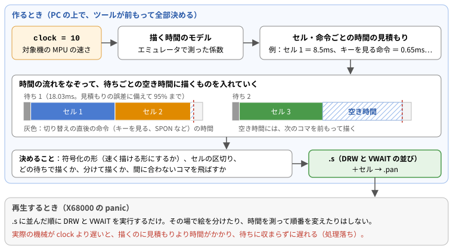
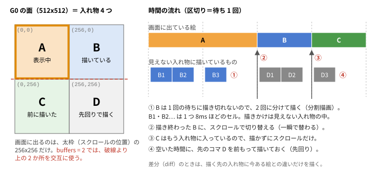
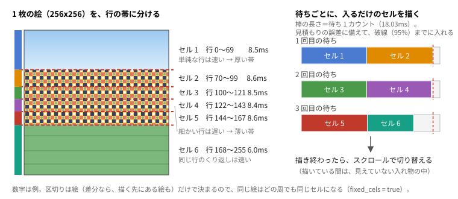

# mkscene.py（層を重ねたアニメーションを 1 コマンドで）

[← 使い方（MANUAL）へ](../MANUAL.md)

```
pt mkscene <設定.toml> [--out フォルダ] [--stop-at-s] [--sim]
```

設定ファイルは「全体の項目」と、`[[layer]]` を並べた「層の項目」からできています。書き間違えた項目や、
書く場所を間違えた項目はエラーで知らせます（例：「fps は層（[[layer]]）の中に書く項目です」）。

## 1. 全体の項目

| 項目                    | 意味                                                                                                                                             | 既定                                                 |
| ----------------------- | ------------------------------------------------------------------------------------------------------------------------------------------------ | ---------------------------------------------------- |
| `name`                  | 出力名（英数字 8 文字以内）。必須                                                                                                                | —                                                    |
| `out`                   | 出力先のフォルダ（設定ファイルからの相対）。`--out` が優先                                                                                       | `x68/anim/<名前>/`                                   |
| `clock`                 | 対象機の MPU クロック：`10`、`16.7`、`"24mhz"` のように書く（1〜100MHz。下の注）                                                                 | 10mhz                                                |
| `loops`                 | 全体の長さ＝基準の層の 1 ループ × loops（永久ループでは 1 周の長さ）                                                                             | 1                                                    |
| `loop = "forever"`      | 永久ループ                                                                                                                                       | 1 回で終わる                                         |
| `exit_key`              | `"any"`／`"space"`／`"return"`／`"none"`                                                                                                         | any                                                  |
| `diff`                  | 前フレーム差分（層ごとに変えられる）                                                                                                             | false                                                |
| `dither`                | 減色のときのディザ：`"none"`／`"fs"`／`"ordered"`（全層共通。止まった背景なら ordered が差分と相性がよい）                                       | none                                                 |
| `dither_strength`       | `"ordered"` のディザの強さ（全層共通）                                                                                                           | 24                                                   |
| `stabilize`             | 前のコマとの色の差がこれ以下のドットは前の色のまま（全層共通。実写のゆらぎ対策。目安 16〜24）                                                    | 0                                                    |
| `buffers`               | グラフィックの描画先の数 2／4（7 章。層ごとにも書ける）                                                                                          | 4（永久ループで 4 だとくり返しが見つからなければ 2） |
| `fixed_cels`            | 区切りを決めたセル（7 章。層ごとにも書ける）                                                                                                     | true                                                 |
| `order`                 | 重なり順（手前から）：`["sprite", "text", "graphic"]` の並べ替え                                                                                 | この順                                               |
| `graphic_order`         | グラフィックの中の順（手前から）：`["g0", "g1"]` か `["g1", "g0"]`                                                                               | g0 が手前                                            |
| `audio`                 | 音のファイル（動画でもよい）                                                                                                                     | なし                                                 |
| `audio_start`           | 音のファイルの何秒目から使うか                                                                                                                   | 0（頭から）                                          |
| `audio_duration`        | `audio_start` から何秒分を使うか                                                                                                                 | 最後まで                                             |
| `gain`                  | 音量の調整 [dB]                                                                                                                                  | 0                                                    |
| `audio_rate`            | 音のサンプリングレート [kHz]：15.6、10.4、7.8、5.2、3.9。下げると音のデータが小さくなり、高い音が出なくなる（下の注）                            | 15.6                                                 |
| `audio_offset`          | 音を鳴らし始める時刻 [秒]（負なら音の頭を削る）                                                                                                  | 0                                                    |
| `audio_every`           | 永久ループで何周ごとに鳴らし直すか（0 で最初の 1 回だけ）                                                                                        | 音の長さから自動                                     |
| `fm`                    | FM 音源の曲のファイル（Z-MUSIC の MML か ZMD。[FM 音源](fm.md) の 5 章）                                                                         | なし                                                 |
| `fm_offset`             | 曲を鳴らし始める時刻 [秒]（0 以上）                                                                                                              | 0                                                    |
| `fm_every`              | 永久ループで何周ごとに曲を頭から鳴らし直すか（0 で最初の 1 回だけ）                                                                              | 0                                                    |
| `[[se]]`                | FM 音源の効果音（`src`・`offset`・`every`・`track`。[FM 音源](fm.md) の 5 章）                                                                   | なし                                                 |
| `aspect`                | ドットの縦横比の補正（横を 2/3 に縮める。全層の既定。[画像の読み込み方](image.md)）                                                              | false                                                |
| `pixel_aspect`          | `aspect` で使う 1 ドットの横÷縦（全層の既定）                                                                                                    | 1.5                                                  |
| `fit`                   | 256x256 への収め方：`"crop"`（埋めてはみ出しを切る）か `"pad"`（全体を収めて余白は透明）（全層の既定）                                           | aspect なら pad、なしなら crop                       |
| `transparent`           | 透明にする色：`"#RRGGBB"`、`"corner"`（左上の色）、`"auto"`（自動で決める）。`";"` 区切りで複数（全層の既定）                                    | なし                                                 |
| `transparent_tolerance` | 透明色の許す差（RGB 各 0〜255。全層の既定）                                                                                                      | 0（auto なら自動）                                   |
| `transparent_fringe`    | 透明色が混ざったふちの色を直す幅（ドット。全層の既定。[画像の読み込み方](image.md) の 3.1）                                                      | 0（しない）                                          |
| `transparent_cut`       | ふち・かぶり取りで透明にする、透明色の混ざり具合（0〜1。全層の既定）                                                                             | 0.5                                                  |
| `transparent_despill`   | かぶり取りの幅（`true`＝4 ドット。全層の既定。[画像の読み込み方](image.md) の 3.2）                                                              | しない                                               |
| `transparent_prescale`  | 動画を 256x256 に縮める前に、縦 256×N の大きさで透明色を抜く（1＝元の大きさ、0＝縮めた後。全層の既定。[画像の読み込み方](image.md) の 3.3）      | 2                                                    |
| `flatten`               | 減色の前に単色のむらを均す（RGB 各の差。全層の既定。[画像の読み込み方](image.md) の 3.4）                                                        | 0（しない）                                          |
| `despeckle`             | 減色の後に孤立した 1 ドットを消す（`true`＝差 24。全層の既定。[画像の読み込み方](image.md) の 3.5）                                              | しない                                               |
| `no_drop`               | 間に合わないコマを飛ばさない                                                                                                                     | false                                                |
| `wait`                  | 待ち方：`"tmwa"`（panic.x の TMWA。遅れは取り戻さない）／`"vwait"`（再生の頭からの予定の時刻で待ち、遅れたコマの分を後の待ちで取り戻す。下の注） | vwait                                                |
| `adjust_every`          | 一定時間ごとの補正：この秒数ごとに、待ちを `adjust_frames` カウント足す（vwait のときだけ。下の注）                                              | なし                                                 |
| `adjust_frames`         | `adjust_every` ごとに足すカウント（負＝早める、正＝遅らせる）                                                                                    | なし                                                 |
| `timelog`               | 再生時間を time.txt に書く                                                                                                                       | false                                                |
| `sim`                   | 最後に pansim で確かめる（`--sim` と同じ）                                                                                                       | false                                                |

**音のサンプリングレート（`audio_rate`）について**：X68000 の ADPCM は 5 つのレートで鳴らせます。レートを下げると、音のデータが小さくなる代わりに、高い音が出なくなります。

| `audio_rate` | 1 秒の音のデータ | 出せる高い音の目安 |
| ------------ | ---------------- | ------------------ |
| 15.6（既定） | 約 7.8KB         | 約 7kHz            |
| 10.4         | 約 5.2KB         | 約 4.7kHz          |
| 7.8          | 約 3.9KB         | 約 3.5kHz          |
| 5.2          | 約 2.6KB         | 約 2.3kHz          |
| 3.9          | 約 2.0KB         | 約 1.7kHz          |

- 声や効果音なら 7.8 でも聞き取れます。音楽は 10.4 以上がおすすめです。
- 15.6 は panic.x の `PCMP` で鳴らします。ほかのレートは、ライブラリの `PCMR`（[LIBRARY.md](../LIBRARY.md) の 6 章）で鳴らします。`.s` には自動で入ります。
- `15625` のように Hz で書いてもかまいません。

**クロック（`clock`）について**：再生する X68000 の MPU の速さ（MHz）です。mkanim・mkparts・pansim・buildPan では `--clock` で指定します。

- **何に使うか**：ツールは .pan を作るときに、「その速さの機械で、この絵を描くのに何 ms かかるか」を見積もり、
  それに合わせてデータを組み立てます（流れは 6 章の図）。clock はこの見積もりにだけ使います。.pan の中にクロックは記録されず、
  再生するときに機械の速さを調べることもありません。
- **clock で変わること**：
  - **符号化**：待ちの間に描き切れない絵は、データが少し大きくなっても速く描ける形に符号化します。速いクロックでは、小さい形のままで間に合います。
  - **描く段取り**：1 回の待ちの間に何を描くか、どのコマを分けて描くか（分割描画）、どのコマを飛ばすかを決めます。
    遅いクロックほど、分割描画や飛ばすコマが増えます。
  - **作ったときの表示**：警告（間に合わない層など）と、`--sim` の再生時間は、このクロックでの値です。
- **実際の機械と違うクロックで作ると**：
  - **clock が実際より遅い**（10MHz で作って 24MHz の機械で再生）：問題なく再生できます。余った時間は待つだけです。
    ただし、本当は要らない分割や飛ばしたコマが入り、データも大きくなります。
  - **clock が実際より速い**（24MHz で作って 10MHz の機械で再生）：描画が待ちに収まらず、コマの切り替えが遅れます（処理落ち）。
    VWAIT が後のコマの余裕で取り戻せないほど遅れると、全体の再生時間が延び、音とずれます。
  - 例（`samples/layer1/scene4.toml`、2 秒、5 層）：

    | clock      | .pan の大きさ | 分割描画 | 10MHz で再生したとき（pansim）  |
    | ---------- | ------------- | -------- | ------------------------------- |
    | 10（既定） | 66KB          | 8 回     | 遅れなし                        |
    | 24         | 39KB          | 0 回     | 切り替えの遅れ（処理落ち）13 回 |

- **決め方**：再生したい機械のうち、**いちばん遅いもの**に合わせます。初代〜SUPER・XVI のどれでも再生したいなら、既定の 10 のままにしてください。
  作ったデータが別のクロックで間に合うかは、`pt pansim <名前>.pan --clock 24` のように確かめられます。
- **見積もりのもと**：エミュレータで測った値です。測ったクロックは 10、12、15、16.7（XVI）、17.4、20、24、25MHz で、
  その間のクロックは測った値から計算し、範囲の外は近いクロックから反比例で推定します（作るときに「対象機：…」と表示します）。
  16.7MHz 以上（XVI 系）では VRAM やスプライトへのアクセスが遅くなるので（塗り約 12％、SPOF 約 60％）、16MHz 以上はその分を見込みます。
  X68030（68030）はこの見積もりの外です。

**待ち方（`wait`）について**：panic.x の TMWA は、前の待ちからの V-Sync を数えて待ちます。描画が待ちの中に収まれば正確ですが、
描画が待ちより長くかかったコマは次の V-Sync まで遅れ、その遅れは取り戻されません（遅い機械ほど全体が延びる）。
`wait = "vwait"` は、.pan に入れた小さな 68000 のルーチンで「再生の頭からの予定の時刻」まで待ちます。遅れたコマがあっても、
後のコマに余裕（1 V-Sync＝18ms 以上）があれば、その分だけ待ちを短くして予定の時刻に戻します。ずっと間に合わないデータは取り戻せません。
既定は `vwait` です（10MHz で確認済み）。panic.x の TMWA だけで作りたいときは `wait = "tmwa"` にします。
仕組みと、自分の .s に組み込む手順は [LIBRARY.md](../LIBRARY.md) を見てください。

**一定時間ごとの補正（`adjust_every`・`adjust_frames`）について**：待ちは V-Sync（1 カウント ≒ 18.03ms）単位なので、
永久ループの 1 周の長さは整数カウントに丸められ、その差が周ごとに積み重なって音と少しずつずれます。
永久ループでは、作るときに「絵は ○ 秒ごとに 1 カウント遅れます（fps どおりにするなら adjust_every = ○、adjust_frames = -1）」
と表示するので、その値を書けば fps どおりの速さになります。耳で合わせたいときは、`adjust_frames` の符号と `adjust_every` を変えて調整します。
例：`adjust_every = 27.1`、`adjust_frames = -1`（27.1 秒ごとに 1 カウント早める）。
早めた所では、そのコマの待ちが 1 カウント短くなるので、描画が間に合わず 1 回だけ V-Sync 1 回分遅れることがあります（次のコマで取り戻します）。

## 2. 層の項目（`[[layer]]`）

| 項目                    | 意味                                                                                                                                 | 既定              |
| ----------------------- | ------------------------------------------------------------------------------------------------------------------------------------ | ----------------- |
| `name`                  | 層の名前（重ならないように）。必須                                                                                                   | —                 |
| `plane`                 | `"g0"`／`"g1"`（グラフィック 256 色）、`"text"`（テキスト面 16 色）、`"sprite"`（スプライト 16 色）、`"bg0"`／`"bg1"`（BG 面 16 色） | g0                |
| `src`                   | 画像（PNG・JPEG・GIF など）の連番のフォルダ、画像 1 枚、動画、またはアニメーション GIF（設定ファイルからの相対）。必須               | —                 |
| `base`                  | 基準の層（全部の中でちょうど 1 つ）                                                                                                  | false             |
| `fps`                   | 1 秒に何コマ進めるか。基準の層には必須                                                                                               | —                 |
| `loop_ratio`            | この層の 1 ループを、基準の層の 1 ループの何倍にするか（fps の代わり）                                                               | —                 |
| `start`                 | （動画・アニメーション GIF）何秒目から使うか                                                                                         | 0（頭から）       |
| `duration`              | （動画・アニメーション GIF）`start` から何秒分を使うか                                                                               | 最後まで          |
| `first`                 | （画像）使い始める画像の番号。ファイル名順に並べて**先頭が 0 番**                                                                    | 0                 |
| `count`                 | （画像）first から何枚使うか                                                                                                         | 最後まで          |
| `sequence`              | 表示する順番（4 章）                                                                                                                 | 0, 1, 2, …        |
| `hold`                  | 画像ごとの表示時間（4 章）                                                                                                           | —                 |
| `diff`                  | この層だけ差分を使う／使わない                                                                                                       | 全体の diff       |
| `buffers`               | この層だけ描画先の数を変える（2／4。グラフィックだけ。7 章）                                                                         | 全体の buffers    |
| `fixed_cels`            | この層だけ区切りを決めたセルを使う／使わない（7 章）                                                                                 | 全体の fixed_cels |
| `aspect`                | この層だけドットの縦横比の補正を変える                                                                                               | 全体の値          |
| `pixel_aspect`          | この層だけ 1 ドットの横÷縦を変える                                                                                                   | 全体の値          |
| `fit`                   | この層だけ 256x256 への収め方を変える                                                                                                | 全体の値          |
| `transparent`           | この層だけ透明にする色を変える（`"none"` で透明色なし）                                                                              | 全体の値          |
| `transparent_tolerance` | この層だけ透明色の許す差を変える                                                                                                     | 全体の値          |
| `transparent_fringe`    | この層だけふちを直す幅を変える（[画像の読み込み方](image.md)）                                                                       | 全体の値          |
| `transparent_cut`       | この層だけ透明にする混ざり具合を変える                                                                                               | 全体の値          |
| `transparent_despill`   | この層だけかぶり取りの幅を変える                                                                                                     | 全体の値          |
| `transparent_prescale`  | この層（動画）だけ透明色を抜く大きさを変える                                                                                         | 全体の値          |
| `flatten`               | この層だけむらを均す差を変える                                                                                                       | 全体の値          |
| `despeckle`             | この層だけ孤立ドットの消し方を変える                                                                                                 | 全体の値          |

同じ面（g0、g1、text、bg0、bg1）に置ける層は 1 つです。スプライトの層はいくつでも置けます（後に書いた層ほど手前）。

## 3. 速さの決め方（fps・loop_ratio・loops）

「1 ループ」は、その層の画像を（sequence があればその順に）最後まで 1 回見せる長さです。

- 基準の層：1 ループ ＝ コマ数 ÷ fps 秒。例：12 枚で fps = 12 なら 1 秒。
- fps を書いた層：その層だけの速さ（基準と関係なく、コマ数 ÷ fps 秒で 1 ループ）。
- loop_ratio を書いた層：1 ループ ＝ 基準の 1 ループ × loop_ratio（コマ数は関係ない）。基準が 1 秒のとき、
  - 6 枚の背景に `loop_ratio = 1.0` → 背景も 1 秒で 1 ループ（1 コマ 1/6 秒）。基準と毎回同時に頭に戻る
  - `2.0` → 基準が 2 回ループする間に背景が 1 回、`0.5` → 基準が 1 回の間に背景が 2 回
- 永久ループでは、1 周（基準の 1 ループ × loops）の中で各層がちょうど整数回ループする必要があります。
  loop_ratio なら `loops ÷ loop_ratio` が整数になるように（loops = 2 なら 2、1、0.5 などは可、1.5 は不可）。

**切り替えの刻み**：panic の待ちは V-Sync（1 カウント ≒ 18.03 ms、1 秒に約 55.46 回）単位なので、
各コマの表示時間は ±半カウントの範囲で丸められます（12fps なら 5,4,5,5,4… カウント）。全体の長さはほとんどずれません。
55.46 を割り切れる fps（27.7、18.5、13.9、11.1、9.2…）にすると、全部のコマが同じ長さになって滑らかです。
永久ループは 1 周の長さを整数カウントに丸めるので、1 周が短いと速さが少しずれます（1 秒の周で最大 0.9% ほど）。

## 4. 順番と表示時間（sequence・hold）

画像の番号は、画像をファイル名順に並べて先頭を 0 番と数えます（first を書いたときは、使う範囲の先頭が 0 番）。

| 書き方 | 意味                                                                     |
| ------ | ------------------------------------------------------------------------ |
| `n`    | 画像 n                                                                   |
| `a-b`  | a から b まで（b < a なら逆順）                                          |
| `:x`   | 表示時間を既定のコマ（1/fps 秒）の x 倍。`:0.5s` のように s を付けると秒 |
| `*k`   | k 回くり返す。かっこでまとめられる：`(0-3)*4`                            |

例：`sequence = "0-7,6-1"`（往復）、`sequence = "0,1,2:3,(3-5)*4"`、`hold = "5:3,7:0.5s"`（画像 5 は 3 コマ分、7 は 0.5 秒）。
hold はその画像が出てくる所すべてに効きます（sequence の `:x` の方が優先）。同じ画像を何度使っても、データは 1 つで済みます。

## 5. 永久ループ・キー・音

- `loop = "forever"` で、キーが押されるまでくり返します。待ちのたびにキーを調べます（1 回 約 0.65 ms）。ESC でも終わります。
- 音は周を数えて、`audio_every` 周ごとに頭から鳴らし直します（ループの本体は音の間隔と関係なく短くできる）。
- 終わるとき（キー、最後まで再生）に音も止めます（PCMS）。
- FM 音源の曲と効果音（`fm`、`[[se]]`）も、同じように時刻と何周ごとかを決めて鳴らせます（[FM 音源](fm.md)）。

## 6. 基本的な仕組み（見積もり・入れ物・分割描画・差分）

**すべて作るときに決まる（描く時間の見積もり）**

自動のツール（mkanim・mkscene）は、**.pan を作るときに**、何をどの待ちで描くかを全部決めます。
その元になるのが、`clock`（1 章）から見積もった描く時間です。



1. **見積もる**：`clock` に合わせて、セルを 1 つ描く時間や、命令 1 つの時間を見積もります（エミュレータで測った描く速さの係数から計算）。
2. **時間の流れをなぞる**：再生の頭から順に、待ちごとの**空き時間**を計算します。
   空き時間 ＝ 待ちの長さ × 95%（見積もりの誤差に備えた余裕）－ 切り替えの直後に実行する命令の時間 － すでに入れたセルの時間 です。
3. **決める**：空き時間に入るように、符号化の形（遅いときは、データが少し大きくても速く描ける形）、セルの区切り、どの待ちで描くか、
   何回かに分けて描くか、間に合わないコマを飛ばすかを決めます。空き時間が余れば、次のコマを前もって描きます。
4. **書き出す**：決めた結果を、.s（`DRW` と `VWAIT` の並び）とセルにして、.pan を作ります。

再生するときの panic は、.s に並んだ順に実行するだけで、その場で絵を分けたり、時間を測って順番を変えたりはしません。
そのため、見積もりより実際の機械が遅い（`clock` が実際より速い）と、描くのが待ちに収まらずに遅れます（1 章の `clock`）。
手で作る場合（[手で作る（mkparts＋buildPan）](mkparts.md)）は、この見積もりと調整をしません（mkparts は描く時間の目安を表示するだけです）。

**描く時間をやりくりする仕組み**

10MHz の X68000 では、256x256 を全部描き直すと 1 枚に 55〜67ms かかり、待ち 1 カウント（約 18ms）に収まりません。
そこでツールは、上の見積もりを使って、次のようにして描く時間をやりくりします。



- **入れ物**：G0・G1 はそれぞれ 512x512 で、画面に出るのはそのうちの 256x256 です。残りの見えない所（入れ物）に次のコマを描き、
  描き終わったらスクロールの位置を変えて一瞬で切り替えます。描きかけの絵は見えません。
- **分割描画**：1 コマを 1 回の待ちの間に描き切れないときは、何回かの待ちに分けて少しずつ描き進めます（図の ①）。
  描く単位は**セル**（1 回で描くひとまとまりのデータ。`fixed_cels` では 1 つ 8ms ほど）です。
- **差分（`diff`）**：描く先の入れ物に今ある絵と、次に出す絵を比べて、変わった所だけを描きます。動きが一部だけの絵では、描く量がほぼ半分になります。
- 締め切り（そのコマを出す時刻）までに描き終わらないコマは飛ばします（`no_drop` なら遅れても描き切ります）。

**1 枚の絵をセルに分ける方法**（既定の `fixed_cels = true`）



- 絵を**横に区切った行の帯**に分けます。1 つの帯が 1 つのセルです。
- 上の行から順に足していき、描く時間の見積もりが**約 8.6ms**（待ち 1 カウント 18.03ms の 95% の半分）を超える手前で区切ります。
  そのため、1 カウントの待ちにセルが 2 つずつ入ります。
- 描く時間は行の中身で決まるので、帯の厚さは場所によって違います。
  - 同じ色が続く行や、上の行と同じ行は速く描けるので、帯が厚くなります（図の空や地面）。
  - 色が細かく変わる行は遅いので、帯が薄くなります（図の真ん中）。
  - 同じ行のくり返しのように 1 つにまとめて描く行は、途中で切れません。そのため、8.6ms を少し超えるセルもあります。
- 差分（`diff`）の層では、描く先の入れ物にある絵と同じ行はほとんど時間がかからないので、変わっていない所は厚い帯になります。
- 描くときは、待ちごとに、待ちの 95% に入るだけのセルを上から順に描きます（待ちが n カウントなら、その n 倍の時間）。
  コマの最後のセルを描き終わったら、スクロールで切り替えます。.s では、セルごとに描く位置をずらした命令になります。

  ```
  	DRW0	256,0,c012		* chara 3 行 0〜69
  	DRW0	256,70,c013		* chara 3 行 70〜99
  	VWAIT	1
  	DRW0	256,100,c014		* chara 3 行 100〜121
  	…
  ```

- 区切りは絵（差分なら、描く先にある絵も）だけで決まります。そのため、同じ絵はどの周でも同じセルになり、データが増えません（7 章）。
- セルに分けるのは、**ツールが .pan を作るとき**です。panic は再生中に絵を分けたりせず、.pan に入っているセルを、.s に並んだ `DRW` の順に描くだけです。
  ツールは作るときに再生の時間の流れをなぞり、「この待ちでは、どの層のどのセルを描くか」を前もって全部決めて、.s とセルにします。
- `fixed_cels = false` では、区切りの決め方が違います。時間の流れをなぞりながら、その待ちに**残っている時間**（見積もり）に入るだけの行を 1 つのセルにします。
  残っている時間は、同じ待ちでほかの層を先に描いたか、前のコマの続きがあるか、などで場所ごとに変わります。
  そのため、**同じ絵でも、スケジュールの中で出てくる場所ごとに区切りの位置が変わり**、別のセルとして .pan に入ります。
  （中身がまったく同じセルは 1 つにまとめますが、区切りが 1 行でも違えば別のセルです。）
- 永久ループで特に増えるのは、ツールが永久ループの「くり返しの単位」を見つけるために、本体を何周分も並べて作るからです。
  層ごとに 1 ループの長さが違うと、周ごとに同じ絵と一緒に描く絵の組み合わせが変わり、残っている時間も変わります。
  `true` なら何周並べてもセルは同じで、増えるのは命令だけです。`false` では、周の数だけ区切りの違うセルが増えます。

  |                      | 区切りを決めるもの                   | 帯の厚さ                                          | 同じ絵をもう一度描くとき |
  | -------------------- | ------------------------------------ | ------------------------------------------------- | ------------------------ |
  | `fixed_cels = true`  | 絵の中身（差分なら描く先の絵も）だけ | 絵の中の場所で違う（単純な行は厚い）              | 同じセルを使う           |
  | `fixed_cels = false` | その待ちに残っている時間             | 描くときの空き時間で違う（約 8.6ms の決まりなし） | 区切りが変わり、別のセル |

  **それぞれの良い所・悪い所**

  |                      | 良い所                                                                                 | 悪い所                                                                                                                                                       |
  | -------------------- | -------------------------------------------------------------------------------------- | ------------------------------------------------------------------------------------------------------------------------------------------------------------ |
  | `fixed_cels = true`  | データが小さい。同じ絵が何度出ても（永久ループ、sequence のくり返し）セルは 1 組で済む | セルが細かいので、待ちの最後に 8.6ms 未満の空きが残り、使い切れないことがある（分割描画が増えることがある）。セルの数と描く命令が多い（1 つ 0.1ms ほど余分） |
  | `fixed_cels = false` | 待ちの空き時間を最後まで使える。セルの数と描く命令が少ない                             | データが大きい。同じ絵でも出てくる場所ごとに別のセルになり、永久ループで特に増える                                                                           |

  サンプルで作り比べた結果（10MHz）です。どれも飛ばしたコマは 0 でした。

  | 設定ファイル                          | `true`：セルのデータ・分割描画 | `false`：セルのデータ・分割描画 |
  | ------------------------------------- | ------------------------------ | ------------------------------- |
  | `samples/layer1/scene5.toml`          | 9KB・2 回                      | 16KB・0 回                      |
  | `samples/layer1/scene4.toml`          | 56KB・8 回                     | 190KB・8 回                     |
  | `samples/layer1/forever.toml`（永久） | 48KB・133 回                   | 394KB・119 回                   |

  **ふつうは `true`（既定）のままにしてください。** データの大きさの差に比べて、`false` で得られる時間の差は小さいためです。
  `true` で「間に合わないので飛ばしたコマ」が出るとき、`false` にすると減るかどうかを試す、という使い方になります。
- テキスト面は行ではなく 4 つのプレーンごとに、BG はタイルの行ごとに分けます。
- mkparts（[手で作る（mkparts＋buildPan）](mkparts.md)）は分けません。1 枚の絵が 1 つのセルです。

**.s が大きくなること**

自動で作る .s は、ツールが決めた段取りを 1 行ずつ書き出したものなので、長くなることがあります。

- **分割描画**：1 コマをセルに分けて何回かの待ちで描くので、セルごとに `DRW` の行が並びます。
  `fixed_cels` ではセル 1 つが 8.6ms ほどなので、全面を描き直す絵 1 枚で `DRW` が 6〜10 行ほどになります。
- **くり返しを書き並べる**：回数の決まったくり返し（`loops`、mkanim の `--loop`）は、`LOOP` 命令を使わずに、全部の周を .s に書き並べます。
  周ごとに、ほかの層との組み合わせや、どの入れ物に何が入っているかが違い、描く段取りも周ごとに違うためです。
  永久ループも、前置きとループの本体（くり返しが見つかるまでの何周か）を書き並べてから、`GOTO` で本体の頭に戻ります。
- **BG 面**：タイルが変わった所ごとに、書き込みの命令（`MOVL`／`MOVW`）の行が並びます。

| 例（10MHz）                                       | .s の行数 | おもな行       |
| ------------------------------------------------- | --------- | -------------- |
| mkparts のひな形（画像 8 枚、手で作る用）         | 46        | `DRW0` 8 行    |
| `samples/layer1/scene4.toml`（2 秒、5 層）        | 288       | `DRW` 119 行   |
| `samples/layer1/forever.toml`（2 秒の永久ループ） | 772       | `DRW` 349 行   |
| `samples/layer1/scene5.toml`（BG 面あり）         | 2324      | `MOVL` 2090 行 |

- 再生には問題ありません。命令は 1 行あたり数〜十数バイトなので、.pan の大きさはふつう、セルの方が大きく効きます
  （例：forever の .pan 63KB のうち、セル 48KB）。
- ただし、人が読んで直すのは大変です。少し手を入れるだけなら [MANUAL](../MANUAL.md) の 4.2 の方法で、最初から自分の考えで組みたいときは [手で作る（mkparts＋buildPan）](mkparts.md)を使ってください。

## 7. 4 面（buffers = 4）

既定（`buffers = 4`）では、G0・G1 の 512x512 を 4 か所の入れ物として全部使います。
`buffers = 2` にすると、上半分の 2 か所だけを交互に使います。

- 次に出す画像がどこかの入れ物に残っていれば、描かずにスクロールだけで切り替えます（図の ③）。
  4 枚以下の層は最初に全部描いておくので、あとは描画時間 0 です。
- 空いている入れ物に先のコマを前もって描くので（図の ④）、忙しい所がならされます。
- 2 か所のときより、描画が間に合いやすくなります（例：bg の飛ばしたコマ 64 回 → 13 回）。
- 永久ループで buffers を書かなかったとき、4 か所では 6 周の中にくり返しが見つからない素材（例：32 枚を 1 枚ずつ順に回すだけの層）は、
  自動で 2 か所にして作り直します（「入れ物 4 つ・6 周ではくり返しが見つからないので…」と表示）。
- テキスト面と BG は 2 か所のままです。
- 層ごとに `buffers` を書けます。コマが多くて差分の効く層（キャラなど）は 2、枚数の少ない背景は 4、のように分けると、
  データが小さく、描画も間に合いやすくなります（下の例）。

**区切りを決めたセル（`fixed_cels`、既定 true）**：分割描画で 1 コマをどこで区切るかの決め方です。

- `fixed_cels = true`（既定）：1 枚の絵を「絵と描画先の絵だけで決まる区切り」のセルの列（1 つ 8ms ほど。6 章の図）にしておき、
  どの周でも同じセルを使います。永久ループで本体を何周並べても、増えるのは命令（数 KB）だけです。
- `fixed_cels = false`：区切りの行をその時の空き時間で決めます。同じ絵でも周ごとに区切りが変わって別のセルになるので、
  永久ループで本体を何周も並べるとセルが増えます。
- 差分なし（`diff = false`）の層は、絵ごとにセルが 1 組だけになります（最初に入れ物を埋めるときも同じセル）。
- 差分の層は「どの絵の上に描くか」でセルが変わります。`buffers = 2` にすると描く先が交互に決まり、差分の元がいつも同じになるので、
  セルは 1 枚に 1 組で済みます。
- 例（永久ループ、キャラ 12 枚＋背景 5 枚、10MHz）：

  | 設定                                                                   | セル   | 飛ばしたコマ |
  | ---------------------------------------------------------------------- | ------ | ------------ |
  | `fixed_cels = false`、どちらも差分・4 か所                             | 1.22MB | 0            |
  | `fixed_cels = true`、どちらも差分・4 か所                              | 0.79MB | 0            |
  | `fixed_cels = true`、キャラ 差分・`buffers = 2`、背景 差分なし・4 か所 | 0.60MB | 0            |
